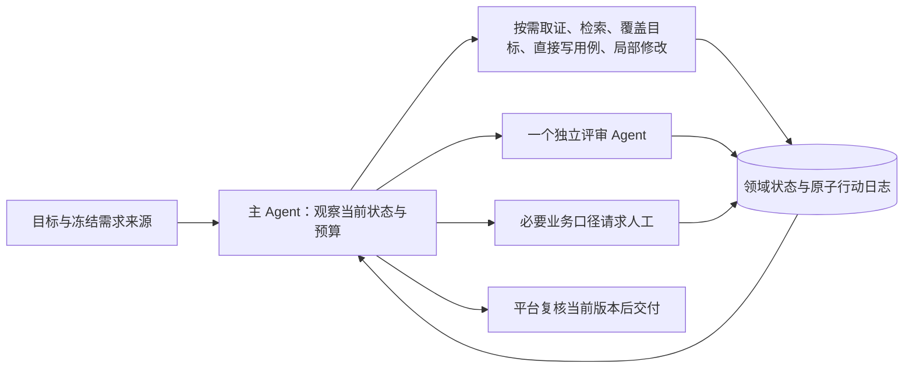

# 单主 Agent 架构与改造方案

更新日期：2026-11-19。本文描述本次清理后的当前实现。先前多层来源治理、草案、归属、支持、分批生成和双层审查方案已退役；旧方案及当时验证记录保存在 [清理前文档](../output/qa/2026-11-13-agent-cost-rerun/pre-cleanup-architecture.md)，不再作为实现要求。

短文档 Run89 实际生成并独审 30 条，耗时 7 分 27 秒，实报 57,984 token。70 条任务保留 Run78 的历史交付和 Run79–83 的失败、取消及未知用量，当前版本仍待新的 70 条完整验收。正式评测 Run91 已用 Run84 和对应的人工执行表完成逐组对比。详见[49组核查回执](../output/qa/2026-11-19-formal-evaluation/49组正文对比.md)。

## 1. 当前边界

一个主 Agent 负责目标、按需覆盖规划、直接编写用例和下一步决策；一个独立评审 Agent 负责审查完整当前版本。覆盖计划是可选辅助结构，不是必须完成的前置模型回合；没有计划仍须接受全来源、全用例独立审查。原文读取、图片读取、项目检索、保存与局部修订都是主 Agent 按缺口选择的能力，不再经过固定多层模型前置。

初始化只读取真实来源、原文/原图锚点、当前任务真实补充以及同用户、同项目、同来源版本的真实批准，不调用模型生成事实、摘要或草案。批准目录按运行首次执行的UTC started_at冻结一次；不把数据库本地created_at与UTC审批时间直接比较，恢复时不重新移动截止点。PDF 类型、日期和某份文档的关键词不参与特殊路由。

通用 DAG 引擎仍服务三个独立评估工作流；它们不作为生成任务的兼容分支。历史 Run、冻结定义、失败证据、审批和产物保留。旧执行签名或旧领域状态不能接入新生成循环，不自动迁移旧 Run。

## 2. 代码与公开合同

| 代码 | 职责 |
| --- | --- |
| [test_generation_agent.py](../backend/modules/agent_platform/test_generation_agent.py) | schema v4 状态、动态合法行动、稳定用例版本、问题生命周期、独立审查与交付 |
| [generation_evidence.py](../backend/modules/agent_platform/generation_evidence.py) | 原文、原图资产、真实批准及本轮用户补充的冻结与校验 |
| [generation_review_contract.py](../backend/modules/agent_platform/generation_review_contract.py) | 全来源分支、实际用例见证及逐用例适用范围回执的编译与校验 |
| [test_generation_schemas.py](../backend/modules/agent_platform/test_generation_schemas.py) | 唯一生成输入、用例、问题、评审和预算合同 |
| [test_generation_builtin_specs.py](../backend/modules/agent_platform/test_generation_builtin_specs.py) | 一个主 Agent、一个独立评审及十个领域工具 |
| [test_generation_workflow.py](../backend/modules/agent_platform/test_generation_workflow.py) | 当前处理器注册，无旧专家注册分支 |
| [sdk_adapter.py](../backend/modules/agent_platform/sdk_adapter.py) | SDK、真实图像传输、受管评审、模型上下文视图 |
| [conflict_confirmation.py](../backend/modules/agent_platform/conflict_confirmation.py) | 当前问题表单、真实人工答复和原检查点恢复 |

生成输入只接受 `requirement`、`requirement_doc_id`、`case_budget`、`batch_case_limit` 和可选 `disable_result_cache`。每批默认 20 条、最多 20 条。旧 `source_context_run_id`、生成压缩开关和容量参数已移除，服务端不再自动注入。

| 工具 | 结果与约束 |
| --- | --- |
| `read_source` | 分页读取原始证据；记录真实读取范围，未读文字不能作为已核对引用 |
| `view_source_image` | 读取冻结文档的原页与真实图片块，验证源文件和图像指纹，实际向模型发送像素 |
| `commit_coverage_plan` | 按稳定 COV 编号增改，未传目标保持；删除须显式remove_coverage_ids，校验版本及现有引用 |
| `append_cases` | 主 Agent 直接写用例，平台分配 TC 编号；可省略覆盖增改及删除字段，实际修改覆盖目标时才检查其预期版本 |
| `patch_cases` | 校验整批身份、版本、来源；同值项原记录保持，真实变化一次原子保存，全批无变化仍拒绝 |
| `inspect_cases` | 按当前编号读取需要的用例正文 |
| `report_issue` | 登记原子问题；模型主张不等于人工业务决定 |
| `request_review` | 审查当前完整版本；同一快照不得重复付费抽取结论 |
| `request_confirmation` | 只提交新issues；已有确需人工事项由状态完整收齐，模型不复写issue_ids |
| `finish_generation` | 在平台重新验收后发布最终产物 |

另外保留现有通用 `retrieve_context`，组合真实项目知识、偏好、记忆、已验证反馈及短期状态。没有“生成中再咨询场景专家”或“批审后另起全局审查”的必经会话。

## 3. 状态与上下文

领域状态使用 schema v4；存储检查点继续使用现有 artifact-journal-v1 / checkpoint v3。两者版本职责不同。

| 状态 | 保存内容 |
| --- | --- |
| `source_ref` / `requirement` / `evidence_catalog` | 冻结来源指纹、原始需求、原文、原图锚点及独立TR任务补充 |
| `approved_decisions` | 真实批准原话、原始问题、审批/用户/项目/来源/时间及状态证明 |
| `goal` | 数量、每次容量与任务目标 |
| `coverage_plan` | 可选辅助计划；采用时保存稳定编号、动作与预期目标、conditions条件、exceptions例外、实际来源引用及版本 |
| `cases` | 单调分配编号、每条版本、完整正文、内容摘要与实际修复计数 |
| `open_issues` | 每个原子问题的身份、影响对象、依据、状态、版本和处理历史 |
| `review` | 精确输入摘要、被审查用例版本、全来源分支source_checks、逐用例适用范围case_checks、原始语义输出、代码编译裁决和当前有效性 |
| `confirmation_requested` | 主 Agent 显式请求或独审明确要求人工决定的当前问题集合 |
| `context_retrievals` | 真实检索 manifest、来源、作用域与采用记录 |
| `delivery` / `completed` | 通过当前验收后的最终产物与完成状态 |
| `projection` | 前端及控制链路读取的薄投影，不代替领域正文 |

模型读取当前目标、合法工具、覆盖目标、用例轻量目录、未决问题、审查状态和实时剩余额度。所有模型工具与独审输出的source_refs只提交编号字符串数组，不提交引用对象或quote；代码按本次冻结目录绑定完整原文、批准答复、本轮补充或已实际查看的图片锚点，内部状态及交付仍保存原文quote。批准引用采用AP-真实审批ID-原问题序号，完整原问题身份、问答、审批时间与状态证明另外保留，不要求模型抄写技术摘要，也不截断猜测旧编号。编号命中只证明来源归属，业务语义仍须结合完整来源独立审查。

原始任务及带EV/AP/TR标记的完整文字材料作为稳定前缀，当前状态只在请求尾部出现一次，不再长留初始状态副本或把current_state二次JSON字符串化。文档输入同时携带的非空requirement作为独立task_requirement来源，保留用户原话、摘要与任务身份，不能丢弃，也不冒充新审批或长期反馈。写作/执行要求不扩成产品用例，真实业务补充按适用范围参与审查。平台记录材料已提供的真实hash和范围，不把它等同于模型已经理解；图片目录不算已查看图片。只有仍未提供的文字才开放read_source。逐条技术hash保留在原始状态和审计，不反复送给主模型。

已持久提交的计划和用例写入，在后续模型视图里替换为可核对的行动回执；原始参数、正文与结果仍完整保存在日志。替换要求真实 completed 回执、工具、参数摘要和结果摘要完全匹配。当前未被成功动作接续的失败提案保留完整参数供修正；显式声明的状态工具在同一原状态成功写入后，可将旧失败参数压为hash与完整错误摘要，标明其未被应用，不宣称业务问题已解决，也不删除state中的未决问题。需要详情时通过原文或用例读取工具取得，不从旧写入参数重建当前状态。

SDK 只在调用时装载图片，状态、事件和日志不保存 Base64。Chat 接口把真实工具图片放在对应回执之后的图片消息中，避免 SDK 默认转换静默丢图；Responses 使用原生图片结果。独立评审附加当前引用且实际查看过的原页，包括用文字引用指向的表格、划线或版面页；只附加真正引用的高清图片块，不自动附加其他图片块。

## 4. 决策、局部修订与问题收敛

主 Agent 根据当前缺口选择下一步，没有固定来源专家、治理、草案、归属、支持的模型串行门禁。平台负责结构、引用、编号、版本、数量、重复和预算；业务解释由模型与人工承担。

实际修改已有对象时检查其预期版本。局部patch只改变指定case_id；混合批次中内容相同且验证有效的条目原样保留，并列入unchanged_case_ids，不因一个同值条目拒绝其余真实修改。全批无变化、重复ID、失效版本或坏引用仍拒绝；任何无效条目均不部分落库。只有真实变化更新版本并触及相关问题，未变化用例不冒充修复。问题不会因新增用例、改名、覆盖计划变化或重新生成而消失。

可以直接提交用例；选择规划时，首批覆盖目标与用例正文可以一次原子保存，不必先经过完整规划回合。已提交的覆盖目标必须显式提交conditions和exceptions，并落实到用例前提、输入或步骤；互斥条件产生不同预期时分别建目标。一般用例可明确限定不适用例外的对象，但整套用例仍须覆盖真实例外；“包含某条件”不自动等于“仅包含该条件”。只另写例外用例不能使无条件的一般断言成立。字段由代码校验，规则解释由模型承担，不匹配某份文档、业务词语或TC编号。

精确达到目标数量且已选择的覆盖目标均有用例关联后，由平台沿原request_review工具自动发起必需的独立审查；没有计划不跳过独审。人工答复后先修稿；已有评审时，每项未决问题须有真实目标进展才自动复审，比较对象可以保持不变。第二次允许修订尚未复核时仍可最终审查，复核后仍失败才触发人工上限。repair_cases直接提供相关用例的当前正文与版本，避免额外读取回合。独立评审获得完整当前用例、单份完整原文、真实批准及本轮补充目录、可选覆盖计划和所有未决问题；技术hash与文字块编号留在原始状态及锚点，不重复发送给文字模型。

独审先从全部已提供文字、真实批准、本轮补充及实际已查看原图独立列出来源分支，再逐条检查当前用例；不把生成器自选coverage_plan当作需求全集。模型仅输出source_checks、case_checks、business_questions、issue_resolutions四个根字段，verdict及issues由代码编译。source_checks逐来源保存行为、条件及例外、实际用例见证、相关来源，以及covered/gap/superseded/reference处置。case_checks恰好覆盖全部当前用例，模型提交scope_reason、valid及additional_evidence_ids；代码沿现有引用关系计算每条用例自身来源与其覆盖目标来源的并集，再合并补充来源，保存内部scope_evidence_ids。模型须解释实际前提、输入与预期如何满足条件和例外；false/gap由代码登记对应问题，不要求模型再次转述。

review_requirements提供真实current_issue_ids、全来源编号及case_scope_evidence_ids。issue_resolutions只处理当前open_issues；AP是已确认历史口径，不再次作为待裁决项。open的coverage_gap可用可选target_case_ids明确更正候选修稿对象；代码保留原issue ID并记录前后目标、理由和来源，重建实际关联及版本基线，更正本身不算已修复。case_error不能借此转移原错稿。模型视图不再展示AP的original_issue_id，但原始状态、批准及来源身份完整保留。未知编号仍拒绝，已知必审范围由代码生成；business_questions的coverage_ids同样沿真实目标用例派生，不让模型猜。每次复审均提交完整两类语义回执，并逐项处置当前问题，不能只关闭旧issue。

来源分支的row.evidence_id始终绑定真实原文，related_evidence_ids只是额外关联。同一来源内部可以存在新旧变更，不强制另找不同来源编号；相关项中的冗余self去掉，未知来源仍拒绝。来源已有明确答案的错稿、覆盖缺漏由false/gap编译登记；用户明确本轮不验的范围可记录reference并注明真实范围依据，不宣称底层规则被删除。真正无法由完整来源及项目知识确定的必要业务判定才交人工，纯格式和同义润色不产生业务缺陷。

平台确定性检查来源集合完整且无重复、用例集合完整、见证及相关来源真实存在、缺口/冲突/无效用例关联实际问题、被替代分支具有依据。approved不能含未解决缺口、冲突或无效用例。内部checked_case_ids由case_checks推导，不再接受仅列编号的旧独审输入协议。这使语义判断有可复核依据；结构齐全仍不能证明自然语言分支提取永不遗漏。

评审结果绑定完整输入与各用例版本；修改后旧批准失效。未决问题只有独立裁决才能结案；人工回答补充规则后仍需修稿和复核。首次发现缺陷后最多允许两次实际自动修订，仍不收敛则请求人工，累计费用和失败计数不清零。

`finish_generation` 要求数量精确、已选择的覆盖目标完整、引用可追溯、无未决阻塞、独立批准对应当前完整版本；交付时重新校验source_checks和case_checks与当前来源、用例及已保存回执一致。最终产物保存来源、分支、用例范围的检查数量与checks_sha256后才写入 `artifacts.test_generation`；失败候选不能通过导出接口成为交付。

## 5. RAG、长期记忆和短期状态

沿用现有 Context Provider / Port，按实际问题组装数据来源，不按固定次序把全部知识塞入每轮提示。

- 项目知识：真实文档版本、锚点和适用条件；参考资料不自动覆盖需求原文。
- 用户偏好：保留来源、项目范围、版本和撤销/替代状态。
- 历史反馈：真实生成稿与人工最终稿的评测差异，经过用户确认才成为同项目可复用规则。
- 短期状态：当前任务的结构化片段、祖先条件、JSON Pointer、完整状态与片段摘要。

长期记忆实现与短期状态实现分别通过已有端口替换；替换必须保持作用域、版本、来源与事务一致性，不增加失败后自动切换存储的兼容分支。

当前生成域尚未把检索正文接入独立评审的引用目录：检索正文在工具回执，状态保存manifest和指纹，提交引用承认原始EV/AP及本轮真实用户补充TR。因此RAG目前用于辅助理解、选取测试角度和准备材料，不能凭检索结果自行覆盖需求；新增业务口径必须有真实用户明确输入或审批，不能把模型推测包装成用户补充。这是长期反馈采用链尚未完成的工程边界，不能仅归因为缺少人工材料。

跨任务复用只限同一项目。模型发现的差异先是候选，不直接写 active 长期记忆。用户需确认业务结论、适用对象/条件和失效条件；拒绝、撤销和被新版本替代的反馈不再采用。Run91 已收到对应 Run84 的人工执行表并产生一条待确认差异，项目长期记忆的实际采用仍待确认与后续同项目运行验证。

## 6. 人工介入与恢复

以下情况应请求人工：完整来源及批准口径仍不能消解的必要业务冲突、来源未承诺但验收必须明确的规则、以及两次实际修订仍不收敛的实质缺陷。模型输出格式错误或平台异常由原代码链修正，不交给用户猜测业务答案。

人工表单保留原问题、影响范围与真实依据。主Agent显式request_confirmation，或独审明确要求人工且对应规范化真实事项时，沿同一暂停链处理。模型只提交新问题，已有needs_human集合由状态收齐。SDK在会话入口、持久输入过滤和Runner返回后检查待确认集合；原生流式后台即使吞掉BaseException控制信号，适配器也在协议纠正或下一次预算准入前向原runtime重新抛出暂停，避免重复确认。提交必须完整对应当前问题集合、节点、运行和检查点state_hash；答复原样保留，不清空其他用例和预算，也不把业务回答自动当作用例批准。

恢复使用现有原子日志、租约与已验收调用回执；相同完整输入命中仍经过当前验收。实际人工等待从执行时限中排除，服务停机不扣除；未知用量保守预留保留，进程重启和重规划不重置额度，同阶段重试保留最早阶段启动时间及更早的已有截止时间。旧执行签名和旧领域状态拒绝恢复；历史记录保持可读。

## 7. 预算、轨迹和 evaluation

当前新 Run 冻结上限：32 次父子共享请求、输入最多 300,000、输出最多 100,000、总量最多 300,000 token，执行时间 1,200 秒。平台更低配置继续生效。所有模型调用包括独立评审，共享同一预算；人工等待另计。

逐请求输入准入使用真实BPE文本分词，加15%且至少256 token的协议余量；图片独立预留，不能把Base64字节当token。代理模型别名须显式声明近似编码配置，估计依据随请求持久化，不冒充官方精确分词映射。服务商回执决定已报告实际用量；无回执请求保留原预留，历史记录不重新计价。下一次准入投影超限不等于已经实耗超限。

轻量请求边界不再被 200 条上限截断，保留每次请求的身份、耗时、用量、错误和未知预留。Run63 已缺失的前缀明细不能补造，完整总账继续保留。

主Agent及独审均通过SDK原生Runner.run_streamed传输，完整消费事件流后仍经过原提交工具、钩子和本地验收。请求显式include_usage=True；会话共享的用量收集器保留原始供应商chunk，按模型及包含工具调用编号的完整终态输出摘要关联on_llm_end，拒绝并发覆盖或重复结算。终态未报告用量时标记usage_reported=False，保留预留，不能把SDK默认零值当实际报告。中断流同样保留未知占用。HTTP504等已分类传输失败在原状态未变化时可恢复同一工具意图，经过原重试和预算边界，不再额外调用主模型来触发审查。

评估分三层：

1. 工程正确性：结构、引用、稳定身份、局部修改不变性、状态/回执/CAS 恢复、取消/失租、人工等待和预算一致性。
2. 完整真实生成：最终交付数、模型请求、执行时间、累计 token、失败/人工等待/未知用量；成功样本必须同时满足数量及成本要求。
3. 人工业务质量：真实需求覆盖、可执行性、错误/遗漏/冗余、人工修改差异及后续同项目反馈采用质量。

成功率按逻辑任务与运行尝试分别统计。失败、取消、历史回放和 CPU 投影不能计为新架构在线成功；单个需求样本不能推导总体准确率。

## 8. 第三、四阶段的验收位置

| 范围 | 当前边界 |
| --- | --- |
| 第三阶段数据能力 | 按需读取、项目作用域、记忆端口和反馈确认接口保留；检索正文与反馈的独立评审引用链尚未接通，不能判定完整闭环完成 |
| 第四阶段生成架构 | 旧多层生成模块和公开配置已删除，当前只有一个主 Agent 和一个独立评审 |
| 当前工程回归 | 最新661项生成平台与相关RAG回归通过，CPU真实数据回放与实时请求分别留证；前端沿用此前19项及构建结果。首轮清理将生成域20,358行收敛为1,233行，净减19,125行，后续按真实问题迭代 |
| 成本验收 | Run89 的 30 条短文档样本达标；当前版本的 70 条交付与成本仍待验证 |
| 人工验收与记忆 | Run91 对比原正文 49 组，排除仅由 SKIP 行对应的 2 组。生成稿完整 44/47，人工稿完整 42/47。差异 #16 待人工确认 |

历史 Run59 虽交付 70 条，但耗时 49分39秒、3,377,421 token。Run63 耗时 51分50秒、3,191,920 token，70 条仅候选、交付 0。它们是旧实现成本失败的依据，不是新架构成功样本。

本次删除前依赖和源码摘要见 [清理清单](../output/qa/2026-11-13-agent-cost-rerun/cleanup-dependency-map.json)，实际实施、回归与剩余验证见 [成本与重构核查结果](../output/qa/2026-11-13-agent-cost-rerun/成本与重构核查结果.md)。在线性能应在代码冻结、服务与 Worker 版本一致后另行记录，不能用离线大小估计代替真实运行。

## 9. Run64真实运行暴露的问题与当前修复

本轮实际8次响应、197,116个报告token（输入192,187、输出4,929），0候选、0交付。总墙钟261秒，人工等待143.106107秒，实际执行约117.894秒。第9次请求因已用量加下一次保守预留305,315超过300,000而未发送；不能把此值当已计费消耗，也不能把快速失败当20分钟验收通过。

真实人工审批16确认“纸质提交后可再做一次；在线仍不重做”，同Run恢复和预算保留通过。其后模型仅提交受影响COV-0019，旧commit接口把整份19项目标覆盖成1项。现改为按ID增改、显式删除，回归证明其他18项完整JSON不变。另将原来领域层隐藏的COV四位编号约束提升为公开Schema共享常量，避免合法Schema输出被额外规则拒绝后重抄全计划。

本轮没有进入图片、RAG、独立审查或用例编写阶段，因此这些节点在真实Run64中的效果仍未验证。修复后的上下文去重和增量合同仅有CPU/工程回归，尚未另开付费运行。完整证据见[Run64真实生成结果](../output/qa/2026-11-16-direct-agent-live/真实生成结果.md)。

## 10. Run65真实复跑与版面引用修复

Run65在AP13/15/16共4条真实批准提前冻结的条件下运行，仍失败、0/70交付。墙钟283秒，7次报告124,640 token，另1次上游504保留87,011未知预留；下一次投影310,625超过300,000被拒。没有进入用例生成、图片、RAG和独立评审，不能声称这些阶段在线通过。

三次覆盖提交被拒的13处引用中，12处仅是PDF断行/版面空白，另1处确实改了业务文字。现引用匹配采用通用Unicode汉字、假名与部首旁的版面空白归一；保留西文/数字/韩文词界、段落、表格与分页边界，不按文档类型关键词放宽，原文、已读范围和hash不变。真实改字继续拒绝，标题去重不受该规则影响。

持久主Agent会话现单独服从Run/阶段剩余执行期限，HTTP仍使用原单次180秒，不能把3分钟HTTP设置当整轮任务时限。此问题来自代码核查；Run65的实际504来自120.069秒上游返回，不能归因为本地180秒会话设置。

该次修复完成时418项回归与服务核对通过，没有改变原Run，当时尚未创建Run66。完整证据见[Run65真实复跑结果](../output/qa/2026-11-16-direct-agent-rerun/真实复跑结果.md)。后续真实任务记录如下；真实反馈采用闭环仍未验收完成。

## 11. Run66–69的真实生成与剩余确认

本轮明确使用同一份文档287、同一来源指纹、同项目的AP13/15/16四条真实决定，关闭结果缓存，未修改旧Run、审批或历史未知用量。输入准入改为可审计的BPE估计；本次代理模型显式配置o200k_base作为近似编码，实际用量仍以服务商回执为准。

| Run | 候选/最终交付 | 已报告token | 结果 |
| --- | --- | --- | --- |
| 66 | 0/0 | 0 | 本地模型目录包装未暴露底层模型名，零请求失败；已修复身份传递 |
| 67 | 64/0 | 261,121 | 6分26秒；三次模型转写原文导致整批拒绝，无效请求69,885 token；改为只选证据编号、代码绑定原文 |
| 68 | 70/0 | 195,898 | 6分13秒；两次429保留54,278未知预留，自动审查准入投影301,504被拒；独审请求未发送 |
| 69 | 70/0 | 277,503 | 批量10条；真实独审检查70条，AP17确认后恢复。未修稿先复审及额外读取耗62,422，下一请求投影323,321被拒；没有未知用量 |

Run69实际分账：成功生成140,370；相同值重复JSON字段被拒15,231；首次独立审查34,698；请求人工明确24,782；人工答复后未修稿先复审35,022；只读取待修用例27,400。人工请求是真实必要口径确认，不归为无效模型回合。原Run及预算完整保留；墙钟6,284秒中人工等待5,914.981923秒，实际执行369.018077秒。新修复另起真实运行，不能把原Run清零或伪装成同一次成功。

AP17已明确第3页清单统一采用第10、13页六种词汇状态，未定义颜色映射不在本轮验收范围。此前的全开放绿点、学前自测只存进度、跟读保存评分与进度、纸质可重做但在线不可重做均已保留，不重复请求用户决定。

工程只读QA额外发现：Run69仍缺收敛刷题“按本讲错题/薄弱点、选词成句、自动跳题”的专项测试，TC0007与TC0062有统计卡交互重复，TC0070的对照错题前置不足。独审已经检查全部case_id不等于业务全覆盖，更不等于用户已执行人工验收。证据：[Run69工程QA](../output/qa/2026-11-16-generation-acceptance/attempt-04/independent-engineering-qa.json)、[真实用量分账](../output/qa/2026-11-16-generation-acceptance/attempt-04/截至人工确认的真实用量分账.md)。

## 12. Run70修复迭代与Run71成功样本

Run70生成70条，两次独审、两次局部修稿，实际283,846 token、366秒，第三次审查因下一请求预算预留超限未发送。自动门槛错误要求所有相关用例都改版，正确的比较对象也被要求修改，多花23,319 token来发起审查。现按每项问题是否有真实目标进展判断，未决问题仍由独审结案；并修正第二次修稿尚未复核时过早触发修复上限的问题。

模型视图删除文字证据技术元数据、逐用例内容hash和重复审查历史；原始状态、完整正文和锚点不变。同一真实70条快照的独审CPU投影从34,428降至24,760 BPE token（减少28.1%），仅为离线视图测量。工具参数仅对类型和值完全一致的重复字段无损去重并记审计，冲突值继续拒绝。

Run71同文、同源、5条真实批准、关闭结果缓存，每批15条。首次429后同Run自动恢复，保留27,486未知预留；一次冲突JSON字段拒绝后自动修正。最终经过两次完整独审和一次局部修稿成功交付70条。5次成功生成花100,108 token，冲突JSON回合20,867，两次独审51,292，局部修稿24,954，合计197,221；含未知预留的审计占用224,707。执行462秒，HTTP提交至完成471.929秒。

最终Excel实测导出200，70行用例及编号与当前持久化产物一致；失败Run66–70导出仍为409。Run64–70及AP13/15/16/17的完整记录摘要在本次执行前后保持不变。服务沿用本次冻结代码，编码配置已持久化到现有backend/.env。

本次工程复核仍发现TC0016数量断言缺少问题词跳过例外，以及有学习记录时清单默认最近教材/册次的漏测，均为自动审查漏报。原交付稿保持真实模型产物，问题记录供人工执行与修改稿对比，不把独审批准当作业务正确性的证明，也未写成已确认长期反馈。完整产物及证据见[Run71真实生成验收](../output/qa/2026-11-16-generation-acceptance/attempt-06/真实生成验收结果.md)。

## 13. 来源分支与适用范围合同，以及Run72的传输阻塞

对Run70/71四次独审的不可变输入核验表明，相关原文均完整提供，实际冻结独审均为同一个DB定义452/version3，系统指令、输出schema、运行配置和模型相同。Run70曾报告两类问题，Run71却漏报；不能归因为缺少来源、改稿覆盖或用户未确认，也不能凭builtin版本号声称审查模型已切换。当时只有checked_case_ids及问题列表的输出，缺少按来源分支和用例适用条件审查的回执，这是本轮改造的可证实合同盲区。

新合同的Run72保留同一文档287、来源指纹及5条已确认口径，关闭结果缓存，每批15条。五次成功生成响应累计105,244 token，实际形成70条和64项目标。只读工程QA确认，新稿分别测试有/无学习记录的默认教材初始化，一般数量/顺序断言已限定问题词跳过例外，并独立测试该例外。这是生成稿的实际改善，不是独审通过证据。

新独审前两次请求分别在120.062秒和120.074秒收到上游HTTP504，没有审查结果或用量回执；并非本地180秒超时。第三次审查在取消前已开始，原Run72及所有无回执预留保留；状态为cancelled，无有效source_checks/case_checks，无最终交付。不能根据耗时猜测未返回的模型思考或实际输出。随后改SDK原生流式与用量关联，未增加模型层级、HTTP隐藏重试或预算额度。

该次发布前512项回归包含真实Run72记录的CPU协议回放，验证流式终态、提交工具、用量挂载及缺回执预算保护；原记录没有SSE分片，回放按真实工具参数与用量投影为协议分片，不是新的实时供应商响应。发布前Run69–72和AP13/15/16/17完整记录摘要保持一致。其后真实Run73结果如下，不能将该次离线结果延用为后续修复已通过。证据见[独审漏报核查与本轮修复](../output/qa/2026-11-16-review-completeness/独审漏报根因核查.md)。

## 14. Run73流式真实结果及再次修复

Run73保留相同来源和已确认口径。五次生成累计103,507 token，三次独审117,215 token，另一次主模型无效重复request_review花23,446 token，总计244,168（输入211,343、输出32,825）。三次独审分别持续183.338、176.565、167.305秒，均完整收到候选和供应商usage，没有504或未知预留。流式传输与用量回收在本次真实任务中通过，但审查候选均拒收，Run最终failed、70条仅候选、0最终交付，不能认定20分钟和30万token综合验收成功。

首轮把AP16已确认的历史问题填进issue_resolutions，而当前open_issues为空。旧反馈只给通用错误、details为空，后两轮反而把AP的全部5个历史问题加入裁决列表，仍不符合当前问题集合。三轮还都将一般数量断言的TC-0020标为valid，却没有核对EV-0023例外；回执漏掉该用例自身声明的来源约束，来源分支也未展开数量规则。此前校验先报AP问题，遮住了后续范围差异。即使手工删除历史issue_resolutions，这些候选也不应视为有效独审，且数量例外仍未修好。

本轮据此收敛现有链路：模型AP视图移除历史original_issue_id，原始记录保留；从当前open_issues和用例/COV引用关系生成精确review_requirements；合并返回问题集合差异、全部scope遗漏及对应COV条件和例外；case_checks新增必填scope_reason，要求说明条件如何支持预期。主Agent spec12与独审spec7明确条件必须落在正文、“包含”不自动表示“仅有”、一般用例限定范围与整套覆盖例外的区别。未添加本需求文档关键词或固定TC匹配。原始三次候选与反馈见[Run73拒收核查](../output/qa/2026-11-16-review-completeness/live-stream/review-rejection-audit.json)，修复后的真实验证见下节。

## 15. Run74完整真实生成与审查验收

修复后533项工程回归通过。Run74继续使用文档287、原来源指纹、5条真实批准及70条目标，未调整20分钟和30万token上限。真实Run最终success；从HTTP提交至完成773.604915秒（12分53.6秒），执行764秒、人工等待0。10次实际模型请求均收到供应商用量，输入235,558、输出37,397、总计272,955 token；charged与reported相等，pending为0、未知预留为0。

本次有两次完整独审。首审真实提出15个问题，其中明确发现一般数量断言缺少“会话完全排除自测答错问题词”的前提，以及混合会话扣除跳过词后的数量/顺序漏测。主Agent沿原patch_cases局部修订：TC-0031 version2明确整个会话没有学前答错的问题词，TC-0067 version2验证普通词与答错问题词混合时，初识数量等于会话总词数减去跳过数并保留其余词序。第二次独审实际复核并将15项全部resolved，保留19项来源/批准、109个来源分支及70条用例适用范围回执；最终scope_reason也分别核对了这两个数量条件，不是仅补EV编号。

最近教材初始化在TC-0005、TC-0054、TC-0055保留有记录/无记录的实际打开清单操作和预期，EV-0004的最终source_checks使用这些真实用例作见证。本次工程终态复核确认上述两类已知遗漏修复；最终19/109/70回执和模型批准不等于其它所有业务细节均已完成人工验收。

最终原生Excel导出HTTP200、17,086字节，实测70行编号与持久化交付一致；失败Run66–70/73导出仍为409。Run69–73及AP13/15/16/17完整记录摘要在执行前后完全相同；已确认口径未丢失，失败和未知用量历史未清零。产物、终态证据、首次问题及最终凭证见[Run74真实生成验收](../output/qa/2026-11-16-review-completeness/live-scope/真实生成验收结果.md)。当前交付证明本真实样本满足生成/审查、数量与成本目标，实际产品执行、人工最终修改稿及同项目长期反馈沉淀仍待用户完成和确认。

## 16. 修稿后的确定性复审触发

Run74另有29,361 token用于主模型仅输出复审动作。对真实修稿前后状态重放后，断点确定在领域进度判断：三个来源覆盖缺口没有既有用例或目标编号，旧公式对空集合永远判为无进度；另一个问题只绑定覆盖目标，目标条目虽未改，其关联用例已经修稿，旧公式同样忽略。SDK原本已在每次工具回执后检查自动行动，无须再增加调度层或模型回合。

当前判断沿问题的已有引用关系定位相关用例：显式用例目标优先；仅有覆盖编号时读取其关联用例；没有旧目标的覆盖缺口按来源引用关联用例及其覆盖目标。只有相关用例相对该问题或上次完整独审的真实版本有变化才送审，纯改计划、批准变化、无关用例修改均不能替代修稿。这里只判断是否应复审，问题仍由独审结案；原日志、预算、同状态失败保护和自动交付链继续使用。

真实Run74回放中修稿前仍不触发、15条修稿后自动触发，原问题和五条人工口径均未改变。Run75在15条时遇到服务进程中断，恢复后又发生上游约120秒HTTP504，最终取消，未作为达标样本。原状态、请求、已报告用量及未知预留均保留，未扣除停机或改写为成功；进程退出原因尚未确定。

恢复核查另发现认领会覆盖已有阶段截止时间，同阶段节点重试也会重新分配20分钟。现改为保留较早的已有截止时间，并从同阶段最早节点开始时间计算预算；不同阶段受总截止约束，真实人工等待仍按原记录顺延。主Agent复用已有SDK原生流式通道，避免非流式响应等待触发网关120秒超时；原预算和次数上限不变。

补充修复后545项工程回归通过。Run76真实证明首次审查由平台直接触发，但首审内两份候选分别因缺陷列表与条件冲突声明不一致、引用未实际提供图片编号被拒，第三次请求中断。该Run未完成修稿复审和交付，不能作为达标样本；实际报告214,945 token，326,560是下一请求拟准入占用而非实耗。旧记录未改写。证据见[Run76独立验收](../output/qa/2026-11-16-auto-review-trigger/live-final/independent-semantic-qa.json)、[复审触发根因核查](../output/qa/2026-11-16-auto-review-trigger/复审触发根因核查.md)及[Run75期限诊断](../output/qa/2026-11-16-auto-review-trigger/run75-deadline-audit.json)。

## 17. 语义判断与确定性回执编译

生成及审查工具的新source_refs统一为证据编号字符串数组，不再要求模型逐个包成对象；代码按冻结目录绑定内部quote及锚点，并无损合并相同编号。旧模型对象输入直接拒绝，内部持久引用对象形状不变。未查看图片只有页码入口，没有可引用编号；独审目录只包含真实提供的文字、批准和已查看图片，不能把未看图片元数据当证据。

独审只输出source_checks、case_checks、business_questions、issue_resolutions。来源分支保留规则、处置及用例见证；用例保留valid、实际适用理由和additional_evidence_ids。代码从当前用例及覆盖目标计算必审来源，与补充来源合并；valid=false据真实理由登记case_error，分支gap登记coverage_gap，结合明确的业务问题和旧问题处理结果计算总裁决。模型不再重复填写verdict、issues、conflicting_case_ids，既减少转述，也消除重复结论互相矛盾后的付费重写。

每轮仍须完整检查全部实际来源及当前用例；适用理由、缺口和业务问题仍由模型判断。代码只编译已表达的语义，不替代独审或用户决定，也不能凭编号集合完整认定业务正确。交付再次校验内部canonical检查结果，不用已经结案后的问题列表重放旧wire处理请求。

该次发布时561项工程回归通过；历史输入只在测试内显式投影，原fixture及失败Run均保持不变。随后Run77生成70条候选，实际报告240,381 token、执行1,140秒，首审编译为needs_human，产生74个待处理记录，其中两项要求明确业务口径。旧SDK只在会话入口检查待确认事项，自动独审返回后错误进入下一轮模型准入，投影300,258超限而失败；该值不是实际消耗。此Run未修稿、未复审、未交付，不计入验收成功。

## 18. 状态驱动调度与当前验收位置

沿原链路继续消除确定性元数据和动作选择开销：append_cases只强制cases，覆盖计划和用例coverage_ids可省略；实际声明的覆盖编号仍须存在，不能用EV编号代替COV。SDK根据available_actions里的当前max_items收窄本次工具Schema，不再让模型看到静态20条却因本轮容量15条整批拒收。代码在自动独审之后立即处理已有人工请求，避免让下一主模型请求消耗预算或遮盖暂停原因。

文档与非空requirement组合输入现在完整保留两者，补充内容独立记为TR来源；真实用户答案可以作为本轮补充与旧批准共同采用，不伪造AgentApproval，也不自动进入长期记忆。用户尚未答复时不能采用推荐选项或把模型的旧结论当成人工决定。

最终584项工程回归通过，前端及后端健康检查HTTP200，Worker已按最新执行签名启动；Run69–77与AP13/15/16/17完整记录摘要一致。2026-11-16收敛时，来自Run77真实独审的混合会话剩余词排序和10月30日自动衔接顺序尚待用户明确，因此当时没有重复发起付费Run；旧五条批准未重复询问。2026-11-17用户答复后沿同一冻结代码实跑Run78，结果如下。

## 19. Run78真实验收：复审不再消耗主模型触发回合

用户真实答复为“剩余词保留自测队列顺序”“采用10月30日新环节顺序”。以本轮requirement补充保留原话及问题上下文，与原文档287和AP13/15/16/17五条批准共同采用；没有伪造审批，没有写入长期反馈。原PDF内容指纹不变，主定义462/version19、独审463/version10、运行签名与上一轮修复冻结值一致。

Run78实际成功交付70条，HTTP提交至终态686.329756秒、节点执行683秒、人工等待0。9次模型请求全部报告用量：输入188,154、输出33,634、合计221,788 token；reported、charged与逐请求账本一致，pending及interrupted均为0。原预算仍为1,200秒、300,000 token与32次共享请求，没有提高上限。

| 实际阶段 | 模型请求 | token |
| --- | ---: | ---: |
| 五批直接生成 | 5 | 94,106 |
| 首次完整独审 | 1 | 31,902 |
| 两批局部修稿 | 2 | 57,615 |
| 完整复审 | 1 | 38,165 |
| 主模型机械触发审查或交付 | 0 | 0 |
| 合计 | 9 | 221,788 |

首审提出23项来源缺口与6项用例错误，部分同一缺口被多处来源分别记录，不等于29个独立业务缺陷。主Agent两批共修订22条，其他48条保持原版本；第二次完整独审将29项全部结案，保留20项来源、137个来源分支及70条适用范围回执。末次生成响应后0.643698秒自动首审，末次修稿响应后0.343222秒自动复审；两次均只有一次有效提交，无拒收重写。交付由platform_finish自动执行，不存在主模型request_review或finish_generation动作空回合。

原生Excel导出HTTP200，70行用例编号与持久化交付逐条一致，失败Run66–70/73/76/77仍为409。执行前后Run69–77和原审批完整摘要一致。完整产物、用量与控制链证据见[Run78真实生成验收](../output/qa/2026-11-17-state-driven-acceptance/真实生成验收结果.md)。本轮没有新增人工事项，不能把未触发的人工暂停链称为本轮已做实时恢复验收；独审批准和有限工程QA也不替代实际产品人工执行。
