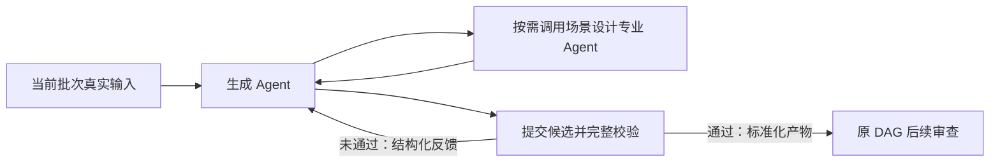
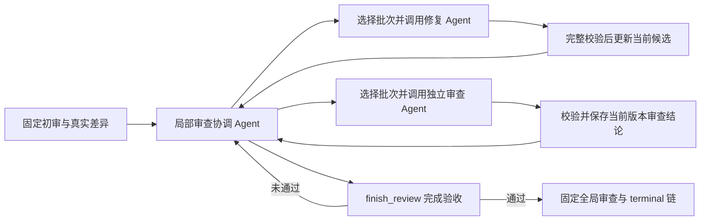

# Agent 自主性演进：保留执行保障，逐步交出行动选择

日期：2026-09-20。

2026-09-24 更新：当前已实现 14 节点统一生成图，以及状态驱动行动目录、异常请求预算收尾、完整意图支持与定向反馈。真实专家复核纠正了一条支持结论与理由矛盾的记录，173 个设计项支持规划及 25 批、50 条预算布局通过；当前父协调者主流程仍在真实模型验收。详见[完整支持演进与证据](2026-09-24-complete-support-evolution.md)和[统一生成实现](2026-09-23-unified-generation-agent.md)。正式 Run 37、38 失败记录保留，旧图 Run 31、36 成功不覆盖新架构正式交付；HTTP 500 已多次定位到实际请求，尚未复现 504，也未闭合自然的生成/终审到上游重规划。

## 当前实现与验收状态

| 能力 | 当前状态 |
|---|---|
| 生成 Agent 按工具反馈修正候选、按需咨询专家 | 已实现并有真实运行证据 |
| 统一父协调者选择局部修复、独立复审和全局审查 | 最新真实诊断完成 8 批修复和独立复审，其中 2 批通过；HTTP 500 中断，仍未到全局审查 |
| 规划阶段自主回查来源、修订草案、重规划及路由复核 | 已实现；历史 Run 36 自主修订草案后完成旧图全链路 |
| 生成/终审识别上游范围问题后，返回规划并重新生成受影响范围 | 已实现统一领域闭环并通过真实数据回放；截至最新诊断仍未自然触发布局调整或重规划 |
| 当前候选、批次映射及有效问题投影 | 已修正并以第二轮真实行动回放验证：1,187 条累计历史问题投影为 43 条当前主张，无关问题身份稳定，旧候选和待复审旧结论不再混入当前观察 |
| 权威标准化回执与父行动交接 | Run 37 暴露二次转换错误；真实回执回放通过，Run 38 事件 7947 自然应用成功 |
| 生成局部预算耗尽后交回父协调者 | 真实回放通过；新隔离诊断自然 inspect item8、改变指导后生成成功并继续全部候选，保留原 61 次消费，未改正式 Run 38 失败状态 |
| 依赖领域版本的旧范围读取压缩 | 回放及模型实测完成；旧支持契约下完成 50 条候选、11 批初审及 8 批修复复审，随后 HTTP 500，不能计为全流程通过 |
| 状态驱动的合法行动和失败请求终态 | 行动目录回放覆盖 18 状态、17 行动；实际 HTTP 500 失败账本 pending=0，未知消费不退款 |
| 完整意图支持、布局承接及修复后派生 | 已实现；真实定向专家修正 1 项矛盾，173 项支持及 25 批布局通过，当前生成和最终交付仍待真实闭合 |
| 只传播未解决反馈和明确行动效果 | 42 份真实回执重验通过；单条草案输入 140,598 → 9,783 字节，当前协调者行为正在验证 |
| 新 14 节点图正式来源到交付全流程 | Run 38 在节点 978 生成 item 8 失败：7 个节点成功、1 个失败、最终用例产物 0；未进入独立审查，非 504 |

此前提议的“下一切片”已经实现为统一目标下的行动闭环，当前工作是验收其真实行为，不能继续把它写成尚未开发的计划。生成遇到范围/数量与语义冲突，或终审出现真实差异时，协调者可以判断问题来自用例表达还是规划；选择局部修用例，或沿真实证据修订草案/模块目标/路由、重新分配批次预算，再生成受影响范围并独立复审。总用例预算仍由用户输入约束；模型一次超量输出不能直接证明原批次不可完成，更不能自动触发预算扩张。来源身份、完整输入版本、事实覆盖、数量和最终落库继续由代码验收。

首版限定同一 `SourceSnapshot` 和原始事实目录，先不开放任意来源解释重写、跨项目记忆或任意 DAG 回卷。重规划会改变模块和事实分组，因此权威协调的准备、专业判断、校验和合并也必须纳入版本失效链；即使 fact_id 不变，也不能直接复用旧裁决。权威、生成和审查都按完整准备输入摘要决定能否复用，已失效的审查不得批准新产物。

实现已组合现有规划、审查领域状态与行动，使用单一父行动检查点，复用原专业 Agent 和校验器，并移除被替代的固定中间节点及公开协调入口。没有把两个持久协调 Agent 互相包装成工具；统一父节点直接组合领域能力，按需调用专业 Agent。

验收要求包括：真实审查差异触发规划修订；旧权威/生成/审查只在完整输入相同时复用；修改后再次独立审查；同一共享预算与检查点可恢复；最终落库只能消费最新验收版本。若真实模型运行未触发跨阶段修订，应明确记录未覆盖，不能把回放或普通成功路径当成自然自主证据。

Run 34–36 的生成反馈修复、模型路由调整、网关诊断属于此前阶段的验收和可靠性修复；统一父节点是本轮新增的跨阶段行动能力，两者分别计证。后续以真实行动链和验收质量衡量效果，不能仅因工具已接入、历史回放通过或请求次数增加就宣称强 Agent 演化完成。

[Run 36 的生成 item 14](2026-09-23-run36-autonomy-audit.md)是本轮真实诊断入口：历史固定 2 条预算下经历超量拒绝，最终 TC-036 混合不同前置和生命周期仍获批准。这暴露了旧实现只能局部修补的能力缺口，但不证明固定预算必然不可满足。当前已移除没有实际输出约束的 `coverage_slots` 任意分配，并统一生成、修复与独立 reviewer 对适用条件、前序动作和独立样本的执行上下文要求。

[第二轮隔离模型报告](2026-09-23-unified-generation-run36-no-slots-real-model.json)用时 1,134.527 秒，92 次已完成请求实际消耗输入 1,877,181 Token、输出 64,530 Token；下一请求因预计输入预留超出 2m 硬上限被准入拒绝，没有 504，pending/interrupted 为 0。有效行动为 12 次修复与 12 次复审，没有自然范围报告、布局调整或重规划；结束时 10 批 43 条差异是模型待判断主张，不是已逐项核实的业务缺陷。

第二轮后的[真实问题投影回放](../../backend/artifacts/verification/run36_problem_projection_real_data.json)验证映射、当前修复候选、范围身份失效和历史/当前问题分离；[当前领域全链回放](../../backend/artifacts/verification/run36_generation_agent_current_projection_domain_audit.json)验证真实完整产物一致、布局变化后有效复用与旧批准拒绝。两者都没有新模型调用或数据库写入。第二轮没有自然全局差异样本；只读代码审查发现同一 `(case_id, category, field_path)` 的新局部差异可能继承过宽的旧全局来源标签并被保守标为 `stale_global`，尚未见实际发生或批准放宽，不能称该分支已实测通过。

正式 Run 37 在 `970/resolve_generation` 的 `reconcile_generation_authority` 失败，错误为 `governed_by.directive_fact_id不能为空`。11 个专家已成功返回标准化回执，父 apply 二次按模型原始字段转换而丢失 directive 引用。现有 validator 已分清原始输出实体化一次与标准化复验；[11 回执及冷启动反馈真实回放](../../backend/artifacts/verification/run37_authority_canonical_and_cold_start_real_data.json)通过并准备出 24 个生成批次、总预算 50，同时验证真实 raw_input 冷启动时过早接受规划得到明确缺规划反馈且状态不变。验证未调用模型、未写数据库，也未改原失败状态。[Run 37 失败终态复核](2026-09-23-run37-failed-e2e-verification.json)确认原 Run 36 全部来源证据不变、Run 37 用例产物为 0，非 504。

Run 37 的父子共享预算记录为 50 次请求、输入 428,490 Token、输出 18,180 Token，pending/interrupted 为 0；持久 `run_context.usage` 另记录 22 次请求、输入 94,855 Token、输出 34,485 Token，attempted_requests 为 24。两份记录覆盖范围不同，分别展示，不将任何一份冒充全运行完整用量。

[Run 37 规划支持矛盾](2026-09-23-run37-planning-support-contradiction.md)仍是未解决的质量风险：模型给免费场景的覆盖意图标 `supported`，同条理由却明确引用只适用于付费且免费缺依据；原始与归一化结论一致，非脏缓存或平台篡改。权威阶段失败使下游纠正未获验证，修复接口不等于验证了规划语义。新正式运行是否完成与是否自然选择跨阶段修订仍须分别记录。

[正式 Run 38](2026-09-23-unified-generation-authority-fixed-e2e.json)的 10 份权威回执已在事件 7947 真实应用，随后准备 21 批、总预算 50 条用例，证明前一轮规范交接修复实际生效。但节点 `978/resolve_generation` 在第二次 `generate_cases [5,6,7,8,9]` 中因 item 8（`M003-B003`，16 条事实、目标 3 条用例）耗尽生成者与咨询子树合计 6 次请求额度而失败。三次咨询中两次 Schema 拒绝、一次建议成功，随后没有额度提交候选或范围报告；建议仍推荐 3 条用例，不能自动解释为预算不足或重规划授权。[真实失败证据](2026-09-23-run38-generation-subtree-budget-failure.md)、[原始 JSON](2026-09-23-run38-generation-subtree-budget-failure.json)。

正式 Run 38 已应用 items 0–4 的 5 批、14 条候选；items 5–7 的 3 批、8 条候选仅保存可信成功回执，尚未应用，item 9 尚未调用。失败行动前后父状态摘要一致，未丢成功回执，也未将半次行动标为成功。父预算为 61/160 请求、输入 605,225 Token、输出 36,097 Token，pending 为 0；Run 汇总另报告 23 请求。该失败不是父预算耗尽或 504，最终仍为 7 节点成功、1 节点失败、交付用例产物 0；未进入独立批次审查，没有问题驱动的布局调整或重规划。

[局部失败交回父协调者的真实回放](../../backend/artifacts/verification/run38_generation_session_failure_real_data.json)已通过：8 份真实成功回执按当前完整契约复验，items 5–7 的成功前缀应用，8 失败不缓存、9 未执行；相同指导的完整请求拒绝，新的具体指导可以准备，总用例预算 50 不变，原 61 次消费经应用及两次恢复不退款，原 MySQL 节点与事件摘要不变。随后建立的新隔离诊断采用当前代码新身份并保留这些消费与有效产物，不是跨版本恢复原正式 Run 38。

[新隔离诊断终态](2026-09-23-run38-local-failure-real-model.json)为 `failed`，但已自然完成 `inspect item8 → 新 guidance → item8 生成成功 → 其余批次完成50候选 → 11批独立初审`。9 批共提出 47 条意见，父随后修复 R-001/R-002/R-004，尚未复审便遇预算准入拒绝；当前 29 条意见加 3 批待复审，不代表 18 条已经审查通过。无布局调整、重规划、全局审查或最终提交。[行动审计](2026-09-23-run38-local-failure-autonomy-audit.md)保留这条自然局部恢复链及明确边界。

原 61 加新增 62，共累计 123 次请求，实际输入 1,778,519 Token、输出 88,500 Token；下一请求保守输入预留累计 2,024,306 超过 2m，被发送前拒绝。pending/interrupted 为 0、无 504，实际消费不等于被拒的预留值。原正式 Run 38 失败状态不变，新隔离诊断没有完成目标。

[item8 人工语义审计](2026-09-23-run38-local-failure-item8-semantic-audit.md)及[reviewer 对照](2026-09-23-run38-local-failure-item8-review-comparison.md)记录真实生命周期/样本风险与审查遗漏，也指出 reviewer 误读：欠费样本实际已经声明，免费/付费按钮的来源冲突也不能直接凭意见改写。人工审计的局部设计支持问题不能外推为整个文档无来源；意见数量不等于已确认缺陷数。

最新诊断第 61 次新增请求中，两份历史 inspect 结果占 111,824 字节、44.57% 的 SDK 序列化输入。当前在已有过滤器声明 `state_snapshot_tools`，领域状态变化后仅压缩模型视图中已登记的旧范围读取，原 journal 与工具配对保留，不改预算。[旧 Run 36 SDK 过滤回放](../../backend/artifacts/verification/run36_persistent_input_filter_after_versioned_reads.json)与本轮 16 项契约检查通过；原始读取字节占比不能直接称为净收益。

[Run 38 真实读取快照 QA](../../backend/artifacts/verification/run38_state_snapshot_filter_real_data.json)已通过：三次真实修复逐步重放的前后完整状态摘要与观察匹配原记录，最终状态匹配原检查点；相同版本读取保留全文，变化后已登记的旧读取过期，未知读取、取证、拒绝反馈、配对、顺序及当前观察保留，篡改输出拒绝。重组的 13 项真实 SDK 输入相对旧过滤方式为 217,421 → 135,522 字节，净减 81,899 字节；只压缩第二份已登记读取，其输出 JSON 为 76,948 → 548 字节。验证没有模型调用或数据库写入，原证据与预算不变。这不是整个历史会话或真实模型费用降幅；所有已报告模型结果仍来自压缩前诊断，新代码尚未执行后续模型验证，完整目标继续未闭合。

以下保留 Run 28–36 的阶段演进和历史证据；阶段章节中的节点数、旧协调入口和“当前”均按当时实现理解，最新能力与验收状态以上述更新为准。历史基线来自真实成功 Run 28，阶段验证使用只读 MySQL 来源和独立 SQLite 行动日志。正式 Run 29、Run 30 暴露的问题已修复；历史 Run 31 的 30 个节点、50 条用例及导出已验证，失败记录与阶段证据继续保留。

## 现状和责任边界

当前测试生成保留 14 节点外层 DAG；来源处理之后，由同一 `resolve_generation` 协调者选择规划、生成、范围调整、局部修复、独立复审及全局审查，最终执行链与交付仍经确定性验收。原 `global_review*`、`terminal_*` 固定节点及被统一父节点替代的中间阶段已删除。历史 Run 31 完成过正式创建服务到新进程 Runtime、结果保存、API 序列化及导出的旧图验证；当前新图的正式 Run 37、38 均失败，仍须完成修复验证及新的全流程验收。HTTP 鉴权、Celery 队列和浏览器下载不在本轮执行路径内。

固定校验本身不代表 Agent 弱。事实引用、来源版本、用例数量、状态恢复和最终落库属于执行系统的责任，增强 Agent 后仍应保留。可以逐步交给模型的是：根据真实反馈判断下一步需要哪些信息、调用哪个专业能力、修改哪些对象，以及是否需要继续请求帮助。模型不能通过自行声明“完成”绕过验收条件。

本文的“完整验收通过”指当前结构、引用、数量、版本约束和独立模型审查全部通过，并不证明所有真实业务语义都已正确覆盖。

更强的 Agent 也不等于无限聊天。自主行动必须受工具权限、预算、截止时间、进展检查和持久化状态约束。

| 职责 | 应由谁负责 |
|---|---|
| 解释业务事实、设计场景、定位语义问题、选择下一项专业能力 | Agent |
| 文档权限、来源和版本、事实引用、Schema、数量、修改范围 | 确定性代码 |
| 工具调度、超时、取消、预算、动作记录、断点恢复 | Runtime |
| 独立审查是否通过 | 审查 Agent 的结构化结果，并经代码校验 |
| 最终完成和产物持久化 | 受验收条件约束的终止工具及 Runtime |

代码入口：`backend/modules/agent_platform/test_generation_builtin_specs.py` 的工作流定义、`test_generation_review_agent.py` 的领域行动、`sdk_adapter.py` 的工具和专业 Agent 绑定、`action_journal.py` 的行动检查点、`runtime.py` 的节点执行和计费。

## Run 28 提供的实际证据

Run 28 持久化了 52 个成功节点，最终产出 50 条用例。节点类型分布如下；一个 `agent_map` 节点可能处理多批输入，因此节点数不等于模型请求数。

| 类型 | 节点数 | 含义 |
|---|---:|---|
| `tool` | 36 | 输入准备、合并、审计、校验、执行链和产物保存 |
| `agent_map` | 14 | 按页、模块或用例批次执行专业 Agent |
| `agent` | 2 | 业务规划汇总、全局终审 |

审查修复链的真实结果：

- 初审 15 个批次，10 个直接通过，5 个未通过，共 23 条差异：业务语义 10、状态连贯性 6、语义重复 4、可执行性 3。
- 首轮修复处理 5 个批次；随后 5 个复审批次全部通过。
- 全局终审实际调用模型 1 次，结果通过，没有新增差异。全局审查与批次审查职责不同，不能因为本例通过就删掉其职责。
- 固定 DAG 仍继续运行了第二轮局部修复和最后一轮修复，两轮都没有待修任务。

本例中可由真实状态跳过的两段固定空链如下：

| 空链 | 六个固定节点 |
|---|---|
| 后续局部修复 | `prepare_followup_final_review_repairs` → `followup_final_review_repairs` → `final_repaired_cases` → `audit_final_repaired` → `prepare_final_review_final_rechecks` → `final_review_final_rechecks` |
| 全局审查后的末轮修复 | `prepare_terminal_final_review_repairs` → `terminal_final_review_repairs` → `terminal_repaired_cases` → `audit_terminal_repaired` → `prepare_terminal_final_review_rechecks` → `terminal_final_review_rechecks` |

这里是 **12 个空链节点，不是 12 次模型调用**。其中四个 `agent_map` 的输入和输出都是空数组，`attempted_requests=0`。两轮合并后的用例与上一轮完全相等，两个重复审计输出也与上一轮完全相等。主要冗余是固定节点、检查点、准备和合并动作，以及零任务轮次记录。

历史 `final_review_repair_cycles` 记录了三轮：待修批次数依次为 **5、0、0**。旧链以准备函数调用次数累加轮次，不能直接将此指标解释为实际完成了三轮修复。新局部阶段使用已接受的行动与候选版本记录进展。

生成阶段已经有动态协作证据：22 个生成批次的持久化工具记录中，存在 4 条明确的 `agent:test_generation_scenario_designer` 调用记录，另有 14 条 `submit_scenario_design_guidance` 工具记录。当前生成 Agent 只直接绑定 `submit_generation_batch`，专业 Agent 绑定 `submit_scenario_design_guidance`。历史外层调用与内部提交记录数量不一致，不能把这两个计数直接相加或当成完整专业 Agent 请求总数；但足以确认已经发生过真实专业 Agent 协作。

## 阶段 1：先让生成 Agent 使用工具反馈完成自主闭环

阶段 1 的改动限定在生成 Agent 内部的行动闭环，保留批次划分、独立审查和落库职责；外层局部审查链的调整归入下文阶段 2。

已实现的行为是：生成 Agent 可以先自行生成，也可以调用场景设计专业 Agent；提交候选后，终止工具执行完整校验。若候选不合格，将结构化问题作为工具结果返回同一轮 Agent 会话。Agent 可以直接修改候选，也可以根据反馈再次调用专业 Agent，然后重新提交。只有完整校验通过，终止工具才允许本次 Agent 调用结束。

实施时保留以下边界：

1. 复用现有 `submit_generation_batch`、`postprocess_generation_batch_item` 及事实、测试设计、字段绑定规则；校验与标准化要有明确的唯一责任入口，不能新增一套较宽松的“Agent 内部校验”。
2. 工具调用名称相同不等于成功。`stop_at_tool_keys` 不能让失败的提交提前结束；最终判定必须来自本次候选的完整校验结果。
3. 业务候选错误可以反馈给 Agent；数据库、权限、取消、来源损坏和不可恢复的执行错误仍应由 Runtime 处理。
4. 原始输入继续作为完整校验和输入摘要的事实来源，投影后的模型输入仅用于控制上下文体积。
5. 记录真实工具动作、候选摘要、拒绝原因、专业 Agent 调用和通过结果。不要记录或要求模型提供思维链。
6. `max_turns`、token、时间和费用预算依然生效；重复提交相同无效候选不能无期限继续。

阶段 1 增强“如何完成当前生成任务”的自主性，本身没有调整历史 52 节点 DAG。阶段 2 首版才将局部固定修复链替换为动态节点，当时仍保留全局审查后的六个 `terminal_*` 节点；它们已在后续扩展中删除，当前总数为 30。

相关复用点：`test_generation_planning.py` 的提交函数、`test_generation_batching.py` 的生成后处理、`sdk_adapter.py` 的工具调用入口、终止工具判定和专业 Agent 绑定。

### 本轮已实现及真实验证

生成 Agent 已启用 `validate_before_submit`：`AgentOutputContract` 把完整原始输入和既有后处理器交给 SDK 提交工具，`AutonomousToolLoop` 将明确的业务差异反馈给当前会话。调用工具不再直接代表任务结束；验收成功后 Runtime 使用已标准化结果，避免再次执行非幂等后处理。移除了提示词中“每批只能咨询一次”和“收到建议立即提交”的限制。

`AutonomousBudgetHooks` 由主 Agent 和专业 Agent 共享。生成的每次 SDK 会话上限为六次模型请求，子 Agent 调用同样占用；每次请求根据实际上下文和输出上限准入，返回后按真实 usage 结算。缺失 usage 保留预留，SDK 与 HTTP 隐式重试均关闭。工具在 SDK 内串行执行；预算耗尽不会被转成业务反馈或外层自动重试。180 秒调用超时和原有实例总额度继续生效。传输故障的显式外层重试仍受实例累计额度及截止时间约束，不能把会话上限误读成所有网络重试合计上限。

工具回执记录真实 `tool_call_id`、状态、候选摘要和校验反馈。失败候选不进入正式输出；整轮异常时，工具正文保存在实例 SDK 状态，事件只保存诊断摘要。生成节点本身尚未接入下文的逐行动持久恢复；阶段 2 的持久行动日志用于审查协调节点，现已覆盖局部和全局审查。

使用 Run 28 的原始输入，通过当前内置生成配置、实际模型路由和 SDK 跑了两个独立批次。数据库强制只读，候选只保存到本地报告，没有新增正式 Run，没有修改历史运行。

| 真实模型批次 | 实际行动 | 请求数 | 结果 |
|---|---|---:|---|
| item 0，2 条用例 | 自行生成 → 提交通过 | 1 | 原有结构、数量和事实绑定校验通过 |
| item 15，4 条用例 | 提交被拒绝 → 根据反馈修正 → 再次提交通过 | 2 | 同一次 SDK 会话完成修正 |

第二批首次遗漏真实事实 `DOC278-P0007-S447-E1020-F0007`。现有完整校验器返回 `missing_fact_ids`，模型收到工具反馈后自行补齐，第二次候选通过。该错误是模型自然产生的，没有预设错误候选或强制行动顺序。

证据报告：[批次 0](2026-09-20-autonomous-generation-run28-item0-real-model.json)、[批次 15](2026-09-20-autonomous-generation-run28-item15-real-model.json)。两批均未主动调用专业 Agent，因此本轮不能声称已通过“在线多次咨询专业 Agent”验证，也不能把批次校验通过视为独立语义终审或完整生成工作流成功。

其他验证均使用真实配置和 Run 28 数据，无 mock：工具回放覆盖重复调用、拒绝后修正、未知回执和旧候选拒绝、平台异常穿透；共享预算回放覆盖实际 SDK 子调用在发模型请求前被拒绝且不可重试、未完成请求恢复和损坏检查点拒绝。缓存身份、缓存复验和候选修复回放通过；阶段 1 的真实工作流契约测试 14 项、内置定义契约 1 项通过。Agent 平台 295 项测试仅完成收集，未运行其中的 mock 测试。编译及 `git diff --check` 通过。

## 阶段 2 首版（历史：52 → 39 节点）

本节文字、图及运行报告记录首版局部审查实现；当前全局审查也已纳入动态协调，见后续扩展。

初审之后原有的 **14 个节点**已替换为一个 `resolve_final_review`，类型为 `agent_network`。删除范围包含首轮修复、后续局部修复、复审合并以及 `preterminal_review_summary`；工作流总节点数由 **52 降至 39**。初审仍产生独立批次结果，新的局部阶段通过后再进入固定的全局审查和 `terminal_*` 链。

`test_generation_review_coordinator` 根据当前差异和候选版本选择 `repair_review_batch`、`recheck_review_batch` 或 `finish_review`。模型只提交批次 ID，领域代码从持久状态读取对应的真实输入，再调用能力白名单内的修复 Agent 或审查 Agent。可以先修多个批次，也可以一批修完立即复审，没有预写“第一轮、第二轮”的控制循环。

领域模块 `test_generation_review_agent.py` 复用既有审查后处理、修复规划、补丁校验、修复合并、增量复审和确定性审计。修复规划已抽出不推进轮次的 `plan_final_review_repairs`，工具准备动作不会凭调用次数累加修复轮数。旧 `prepare_final_review_repairs`、`merge_final_review_recheck_records` 不再作为公开工具绑定；内部领域能力继续按职责复用。

专业 Agent 返回结果经过 Schema 和对应的完整逐项后处理，验收仍使用完整原始输入。通过后才替换领域状态，Runtime 消费已标准化结果，避免重复执行后处理。修复不能修改目标范围以外的用例；复审仅更新其实际用例范围，同一批次 ID 下的局部复审不能清除其他用例未解决的差异。

每个实际复审范围的用例和事实绑定必须发生变化。同一范围的无变化修补会被拒绝，已经审查过的候选版本也不能通过 `A → B → A` 回退重新抽取审查结果。旧行动准备结果不能应用到已经变化的状态。`finish_review` 仅在当前确定性审计通过、修改都已复审且不存在未解决差异时接受；自由正文不能绕过终止契约。这里完成的是局部审查阶段，全局审查仍由后续独立节点执行。

### 已实现的持久化和恢复边界

`AgentActionJournal` 复用节点 `sdk_state.action_checkpoint`，保存一份当前领域状态、输入和状态摘要、行动回执及预算。工具开始、成功或拒绝分别提交行动记录；状态、回执和事件在同一数据库事务中保存，工具失败时恢复到上一个已提交状态。事件只保留小摘要，完整候选不随每条事件复制。

已完成行动按原 `tool_call_id` 返回持久回执，不重复调用专业 Agent 或应用补丁。恢复时从领域状态重建模型可见摘要并开启新 SDK 会话；**这不是精确恢复原 SDK `RunState`、聊天历史或未结束的模型调用**。处于 `started` 的行动需要显式恢复，且参数与起始状态必须匹配。

本阶段当时的恢复粒度是完整工具行动：多个专业子调用中途断开且未原子提交时，可能重做此前子调用，当时没有逐项持久成功回执。2026-09-23 统一生成接入已在原检查点补齐逐项已验收回执，详见[当前专业回执证据](2026-09-23-unified-generation-agent.md)；模型返回至回执落盘之间仍有重做窗口，不能声称每一次请求都恰好执行一次。

父协调 Agent 与所有专业子调用共享请求和 token 预算，请求前先持久预留，已返回的请求按真实 usage 结算；中断且 usage 未知的请求保留占用，不退款。恢复沿用原预算和消耗，不重新发放额度。运行时预留、结算及已完成检查点迁移均有幂等标记，复制已完成节点不会给新 Run 记入旧用量。工具行动总数也由持久回执累计，不因新建会话而重置。

行动提交检查运行状态、租约有效期和执行器认领标识；失去租约、被取消或被新执行器接管的旧执行器不能继续写入。执行身份快照固定当前 Agent、专业能力与执行契约，恢复时身份变化会拒绝混用旧状态。专业调用的明确业务或结构错误可以作为反馈继续修正；来源、权限、平台工具协议和预算等错误仍向 Runtime 抛出。

### 阶段 2 验证证据及尚未覆盖的范围

首轮真实模型验证使用 Run 28 完整初审阶段的 **50 条用例、15 个批次、5 个待修批次**，调用当前协调 Agent 和真实专业 Agent，没有强制行动顺序或预设错误。结果为 `passed`，耗时 **160.194 秒**，共 **24 次模型请求**：协调 Agent 7 次、修复 Agent 10 次、审查 Agent 7 次。实际接受 **7 次修复、7 次复审**，出现 **3 次工具拒绝**，最终 `finish_review` 接受；局部审查和完整确定性验收通过。

证据：[首轮真实模型报告](2026-09-20-review-agent-run28-real-model.json)、[独立行动数据库](2026-09-20-review-agent-run28-real-model.sqlite)。请求数包括被拒绝行动已经产生的专业调用，不能将 7 次成功修复等同于只有 7 次修复模型请求。

首轮之后又补齐了执行身份快照及专业错误回传。第二轮真实模型运行在 **155.807 秒**后因专业子调用 `InternalServerError` 硬停止，父 SDK 抛出 `UserError`，报告状态为 **`failed`，不能记为通过**。中断前已有 1 次修复原子提交，候选推进到 `generation_version=1`；另有 1 次明确业务拒绝和 1 次服务调用失败。已收到 3 次模型响应，另有 1 次请求未结算，预算保留全部 4 次请求的占用，没有把未知 usage 退款。

随后从该检查点做了两次真实续跑，均通过输入、执行契约、领域状态和原预算恢复检查，但根 Agent 的模型请求再次遇到 `InternalServerError`。最初子调用的原始错误页为 `504 Gateway Time-out`。当时停止继续请求，没有更换模型或重置预算来绕过问题。两次失败后仍保持 `generation_version=1` 和相同状态摘要，累计占用 6 次请求，其中 3 次已有响应、2 次已记为中断、1 次未结算；原始报告及 SQLite 证据摘要保持不变。

证据：[第二轮中断报告](2026-09-20-review-agent-run28-durable-real-model.json)、[首次续跑](2026-09-20-review-agent-run28-resumed-real-model.json)、[再次续跑](2026-09-20-review-agent-run28-resumed2-real-model.json)。两次恢复都从只读来源复制独立 SQLite 后继续，原证据不被覆盖。这些失败记录验证了状态和预算恢复，本身不构成局部终审通过的证据。

用户随后要求跑一轮定位节点。补充逐请求耗时、批次、模型路由及上下文体积观测后，从最后一个检查点执行一次真实续跑，**90.730 秒通过，新增 16 次模型请求**：协调 5 次、修复 6 次、复审 5 次。原 504 位置 R-003 的专业任务输入摘要相同，本次 5.238 秒返回；本轮未复现网关错误。R-002 自然产生两次拒绝，分别为预期结果的事实绑定为空、补丁数量超过 6 个修复目标；错误候选均未推进领域状态。三次 R-002 专业调用都收到与 Agent 和完整输入摘要匹配的 `retry_feedback`，第三次修复通过，随后独立复审通过。

因此，**当时的补强版本完成了从失败检查点恢复到局部终审验收的真实模型验证**。最终 50 条用例通过完整确定性校验和分批审查，领域版本由 1 推进至 5；历史 R-001 修复未重复执行。累计预算占用 22 次请求，19 次有响应，3 次历史中断保留占用，`pending_requests=0`。完成后重开 SQLite 并经实际 SDK 恢复，新增模型请求为 0，输出、预算及检查点不变。原来源报告、数据库和终态回执保持不变。证据：[诊断续跑报告](2026-09-20-review-agent-run28-diagnostic-real-model.json)、[节点定位说明](2026-09-20-review-agent-gateway-diagnosis.md)。这仍是独立 SQLite 上的局部阶段验证，没有新增正式运行或覆盖全链路 E2E。

真实历史回放与 SQLite 验证已通过：

- `verify_review_agent_real_data.py`：按另一合法批次顺序回放 5 个真实修复批次，最终用例和绑定与历史结果相同；覆盖提前结束、旧行动、无变化候选、版本回退、局部复审范围和业务错误类型边界。
- 同一脚本两次关闭并重新打开 SQLite，覆盖未完成行动显式恢复、完成回执复用、提交故障后的状态/回执/事件共同回滚、输入变化拒绝、失租和取消拒绝，以及外部未提交事务不被工具擅自提交或回滚。
- `verify_action_quota_real_data.py`：采用真实历史模型用量及当前协调 Agent 预算，覆盖同 Run 恢复不重复预留、部分检查点迁移保留消耗、重复预留和结算不重复计费，以及已完成节点迁移后新 Run 用量保持零。
- `verify_terminal_claim_real_data.py`：成功与失败终态分别验证有效、过期和被替换的租约，失租不会改变节点、运行或事件。
- `verify_agent_cache_identity_real_data.py`：现有执行指纹覆盖专业 Agent 定义、工具、模型及状态处理器变化，缺失身份的已有行动检查点不能补写身份后继续。
- `verify_review_tool_recovery_real_data.py`：实际 `finish_review` 提前提交被拒绝；两次重开 SQLite 后，第三次调用仍被累计工具额度拦截，领域状态不变。
- `verify_review_completed_restore_real_data.py`：回放 10 条真实历史领域转换，再通过实际终止工具完成验收；关闭 SQLite 会话及 Engine 后，实际 `run_agent_async` 从完成回执恢复，50 条用例的标准化结果、状态、回执、预算和事件均不变，模型请求为 0。[验证报告](../../backend/artifacts/verification/review_completed_restore_run28.json)。这是历史结果回放后的 SDK 恢复；真实模型续跑及其完成检查点恢复由上面的诊断续跑报告单独证明。
- 当前内置工作流静态契约测试通过，确认新的动态节点、专业能力白名单和终止工具，以及旧节点和公开工具删除。

阶段 2 首版的真实工作流契约、内置定义、工具注册及真实投递记录测试合计 **18 passed**。Agent 平台 **295 项仅收集**，未运行其余含 mock 的测试。生产模块和新增验证脚本编译通过，`git diff --check` 通过。

以上分别是阶段 2 首版的领域回放、SQLite 恢复验证和局部阶段真实模型运行；未执行 MySQL 并发锁竞争、操作系统强杀后的在线恢复，当时也未重新跑完整文档解析至最终保存的全链路 E2E。全局审查及末轮修复的后续动态化见下文阶段 2 扩展。

### 始终保留的能力

- 来源和事实建立：证据解析、文本/图片事实、规划和权威协调。
- `build_generation_audit_summary` 的事实及测试设计覆盖审计。
- `approve_synthesized_test_cases` 的终审、数量和绑定门禁。
- `validate_generated_test_cases` 的最终用例结构校验。
- 执行链准备、选择与校验的职责。
- `persist_generated_test_cases` 的最终产物契约及 Runtime 事务保存。
- 各次实际动作的输入、结果、错误、预算和恢复证据。

可以删除的是重复轮次的编排表达；不能随之删除上述业务规则。`persist_generated_test_cases` 当前主要构造 `context.artifacts["test_generation"]`，真正的运行产物持久化由 Runtime 完成，改造时必须保留这个提交边界。

## 阶段 2 扩展：将全局审查纳入持久行动闭环

本轮在 `resolve_final_review` 上扩展现有状态和行动，没有增加第二套协调器。新增 `review_all_cases` 工具，由协调 Agent 在当前批次差异和复审任务清空后选择调用。工作流删除两个全局节点、六个末轮修复节点和一个批审汇总节点，总数 **39 → 30**；最终审批直接读取协调器已经验收的领域结果。

全局审查发现差异时，复用原有按 `case_id` 路由及字段映射规则，将差异送回原批次。Agent 再选择修复、批次复审及新版本全局审查，直到当前版本完整通过或原有预算、时间等边界终止运行。修复全局差异时提供当前全局用例索引作为只读对照，`target_case_ids` 仍是唯一允许写入的范围，事实和测试设计覆盖规则不变。

本轮修复了旧固定链的一个缺口：旧全局结论产生后，末轮修复会改变用例，但不再进行全局审查。新状态同时保存完整用例版本和全局实际输入摘要，任何用例或绑定变化都不能复用旧批准。另以全局可见的 `case_index` 记录已审历史；修改背景摘要、重复审查相同索引或回退已经审过的内容，都不能换取新的通过结果。局部审查的范围版本历史继续保留。

全局来源的跨批重复差异保留可信来源标识，避免在构造修复任务时被局部“没有重复事实”的误报过滤吞掉。最终结束同时要求当前完整版本的确定性审计、批次审查、全局审查通过，协调 Agent 不能自行改写批准标记。

已删除五个只供旧 DAG 调用的公开准备/合并工具，以及两个按函数调用次数累加固定轮次的包装函数；内部差异路由、修复规划、合并及审查校验按领域职责复用。该扩展当时将持久状态升为 2，阶段 3 又升为 3；旧执行契约的检查点继续受身份校验约束，不作静默兼容迁移。

真实历史验证已完成：Run 28 的五次修复、五次复审和一次真实历史全局结论，共 11 次领域动作；实际终止工具提交后共 12 条完成回执。缺全局审查、旧版本批准、重复全局内容和过期行动均被拒绝；SQLite 重开后经实际 SDK 恢复，50 条用例、状态、预算、回执和事件均不变，模型请求为 0。[恢复报告](../../backend/artifacts/verification/review_completed_restore_global_run28.json)。历史全局输入仅 `batch_review.summary` 与新摘要文字不同，其余字段一致；这是历史输出的领域回放，不冒充相同输入的新模型调用。库内六条真实全局审查均通过，没有可用于回放的真实全局拒绝后修复样本。

从原始完整初审输入新跑的真实模型验证耗时 **249.471 秒**，因 `AgentExecutionBudgetExceeded` 结束，状态 **failed**。40 次请求全部收到响应，没有 504：协调 Agent 20 次、修复 Agent 13 次、批次复审 Agent 7 次。R-002 完成三次有效修复及三次复审，最终通过；R-007 最后一个候选遗漏 `DOC278-P0001-S0-E601-F0024`，被事实覆盖校验拒绝，仍有 3 项语义差异待修。最终领域版本为 7，`pending_rechecks={}`，全局审查尚未调用；预算 `completed_requests=40`、`pending_requests=0`、`interrupted_requests=0`。六次拒绝的前后状态摘要均一致，错误候选未提交。保留原预算与失败证据，未通过放宽校验或增加额度把该次运行改成成功。[完整初审起点的真实运行报告](2026-09-20-review-agent-run28-global-real-model.json)。这次暴露的是修复收敛和协调请求开销，不能计为全审阶段通过。

为单独验证本轮新增的全局行动，另从 Run 28 已保存的 `repaired_cases` 和五条真实复审结果重建批次全部通过的输入，进行了一个独立专项。协调 Agent 自行选择 `review_all_cases`，真实全局 Agent 批准后再调用 `finish_review`，50 条用例通过完整验收；共 **3 次真实请求、8022 tokens**，无拒绝和 504。全局模型请求耗时 **3.671 秒**，SDK 上下文为 **26997 字节**。这不是给前述预算耗尽的运行增加额度或续跑，也不能替代完整初审起点的验证。

该专项原报告保留 `status=failed`：实际模型及业务验收完成后，验证脚本错误地要求完成态恢复返回的累计 `usage` 为零，触发断言。生产 SDK 的正确契约是返回持久检查点的历史累计用量，由 Runtime 的 `action_usage_recorded` 标记保证幂等结算；“没有新增请求”应通过本次请求记录为空及预算、累计用量不变验证。已修正脚本断言，原模型报告与 SQLite 不覆盖。[专项原始报告](2026-09-20-review-agent-run28-global-scope-real-model.json)。

完成态专项复验已通过：复制上述真实 SQLite 检查点并经实际 SDK 恢复，新增模型请求 **0**；累计用量仍为 3 请求 / 8022 tokens，完整产物、预算、状态、回执和事件均不变，原报告及数据库摘要保持一致。[独立完成态复验报告](../../backend/artifacts/verification/review_completed_restore_global_scope_real_run28.json)。另从只读 SQLite 重新执行当前完整输出契约，50 条用例和输入、状态、全局实际输入、可见索引、最终产物摘要均匹配。专项覆盖全局批准成功路径，尚未覆盖真实全局拒绝后的修复闭环，当时也未运行新的全链路 E2E。

这轮失败明确了后续改进范围：40 次请求中有 20 次用于协调；当时修复候选被完整校验拒绝后仍返回协调 Agent，再发起专业调用。上述预算可见性和专业会话内修正已在下一轮实施，结果见下文，原失败报告继续保留。

### 已补齐：专业会话内验收与动态共享预算

SDK 为由领域行动调用的专业 Agent 提供通用 `submit_result`，工具参数直接来自该 Agent 的原输出 Schema，完整验收仍调用既有 `AgentOutputContract` 和业务后处理器。可选补丁字段保持可选，省略字段仍表示保留原值。明确的候选错误直接作为工具反馈送回当前专业会话；专业 Agent 修正后再次提交，只有验收通过才返回协调器。没有增加固定修复轮次或隐式重试。

父子 Agent 的动态 instructions 在每次请求前读取同一个 `AutonomousBudgetHooks.observe()`：限额、已占用量、余额和 pending/completed/interrupted 状态均从原账本派生。当前请求也要消耗该余额，实际准入仍由请求前的真实上下文计量决定。专业会话的执行轮次受父级原请求上限和自身超时共同限制，不额外发放预算；恢复未知用量不退款。

专业修复候选在子会话内还会在领域状态副本上验证当前目标范围是否实际变化、是否退回已审版本。一个行动有多项任务时，各项成功后仍经完整合并和全局版本检查，最后一次性提交父状态。源输入的目标集合、模块和原始绑定校验移出可修复输出边界，输入损坏不会再被专业会话当作候选差异反复修正。

从 Run 28 **完整初审起点**再次实际执行，**172.584 秒通过，34 次请求 / 311211 tokens**：协调 14、修复 13、分批复审 6、全局审查 1。原请求次数上限保持 40，没有重置或补发额度；输入 token 预留由当前完整上下文按既有规则计算。

专业会话自然产生 **7 次拒绝**：R-002 遗漏事实 1 次；R-007 空事实绑定、遗漏事实及测试设计覆盖缺口 4 次；R-001 第二轮重复测试设计 ID、非法 JSON 2 次。每组均保持相同专业输入和父行动 ID，SDK 对话项随反馈续接，随后 `submit_result` 接受。父阶段只提交 **6 次有效修复、6 次复审、1 次全局审查和1次完成验收**，最终领域版本为 6；子会话中的拒绝不推进父版本。50 条用例通过全部验收，没有 504，预算 pending/interrupted 均为 0。

完成态关闭并重开 SQLite，再调用实际 SDK，新增模型请求为 **0**，完整产物、累计用量、预算和检查点保持不变。[真实完整审查报告](2026-09-20-review-agent-run28-convergence-real-model.json)。该成功样本证明本次输入可以在原请求次数上限内收敛，不代表所有文档都必然在 40 次内完成，也不能把请求数下降直接称为 token 下降。

真实数据验证还包括：实际 SDK 动态 instructions 读取同一预算、真实其他批次产物被拒绝后在同工具循环提交正确历史产物、五份历史有效修复产物前后相等以及输入损坏与候选错误分离。[预算集成报告](../../backend/artifacts/verification/autonomous_budget_observer_sdk_run28.json)、[工具回放报告](../../backend/artifacts/verification/specialist_submission_run28.json)、[输入边界报告](../../backend/artifacts/verification/review_repair_input_boundary_run28.json)。错批产物回放明确属于契约验证，不冒充自然模型失败；自然模型修正由上述 34 次真实请求单独证明。

### 正式模型请求诊断

此前仅在验证脚本里的观测已抽入正式 `request_diagnostics.py`，SDK 父子请求共用观察器。发生 504 等异常时，具体运行/节点、Agent、行动/批次、模型路由、输入摘要、请求起止与耗时、上下文字节数和输出上限随现有 `error_diagnostic` 持久化；可用的 HTTP 状态、网关请求标识、服务器及响应类型一并保留。上下文字节数明确标注为 SDK 序列化度量，不冒充 HTTP 报文大小。

诊断不保存认证头、完整端点或模型输入正文，不新增日志表，不修改预算或隐式重试。SDK 将传输错误包装为 `UserError` 时恢复其原异常类型，使既有 Runtime 能按真实服务错误分类。旧真实 504 的离线重建、共享预算 10 项和自主工具回放通过；旧证据没有响应头，尚不能声称实测到了下一次网关错误的请求标识。[诊断验证报告](../../backend/artifacts/verification/request_diagnostics_run28.json)。

## 阶段 3：审查阶段的持久目标与按需取证已实施

复用 `action_checkpoint`，没有新增记忆库或表。状态版本升为 3，保存由完整输入派生的目标、用例及批次范围、固定验收条件、本次 Run 的 `SourceSnapshot` 和事实目录摘要；这些字段不能由模型改写。已有的候选版本、未完成差异、行动回执、有效审查和预算继续复用。业务状态与 SDK 会话 `RunState` 含义不同，恢复仍依据持久业务状态重建会话。

新增 `read_review_evidence`：模型按需读取本次 `action_input.authoritative_facts` 中的真实事实。`fact_id=null` 分页读取目录，具体 ID 分页读取完整事实 JSON，每次最多 4000 字符。仅保留本次来源和版本内的数据，来源锚点与状态原样提供；不查活文档、不扩大项目或文档范围、不自动新增权威事实。完整原始输入继续用于验收。

取证进度只保存事实指纹及归并后的已读区间，重复读取不产生虚假进展。读取成功不代表审查通过，也不修改正式候选。协调 Agent 可以选择先核对证据，再修复或独立复审；是否结束仍由当前版本的完整验收决定，预算、取消和失败边界不变。

Run 28 的 219 条真实事实目录分 5 页读取，片段精确拼回原文；未知事实、越界、目标或来源版本漂移均被拒绝。实际 SDK 工具调用后重开 SQLite 能恢复读取区间，重复读取不增加进度，用例与审查不变。[持久目标与取证验证](../../backend/artifacts/verification/review_agent_goal_evidence_run28.json)。本轮真实完整审查没有主动读取证据，不能把该工具的领域和恢复验证称为模型实际使用证明。

自主范围包含生成批次内部，以及初审之后的整个审查阶段；正式验收暴露的业务规划提交问题也按下节接入同会话反馈。文档来源处理、阶段依赖和最终落库仍保留外层 DAG 的确定性职责；没有把整个工作流改成无边界的总控 Agent。跨阶段重写来源或任意改变用例预算不属于已开放能力。

## 正式全链路验收发现的规划阻塞

Run 29 使用同一真实文档重新执行当前 30 节点工作流，前八个节点成功，业务规划 `plan` 的两次候选均被严格校验拒绝，运行实际为 failed。共 24 次请求、154828 tokens，未进入动态审查。第一次遗漏 `CG-0004、CG-0009`，重复 `CG-0017、CG-0029、CG-0053`；第二次补回遗漏并修正跨模块的 `CG-0029`，但仍将 `CG-0017、CG-0053` 分配给同一“续约审批管理”模块内的多个测试点。不是 504，也没有 pending 模型请求阻塞的证据。

该节点仍使用一次性提交后外层重试，错误反馈只有编号。修复复用既有 `submit_business_plan` 和 `AutonomousToolLoop`，在当前会话中返回覆盖组的全部冲突位置，由模型依据原始语义选择唯一归属；不由平台任意去重或改变事实。提示明确全局唯一性覆盖所有模块、测试点及测试方法。源输入的目录、容量和已验证草案先行检查；候选错误才进入模型反馈，坏输入不会被当作模型可修复对象。

规划 v4 的单次会话上限明确设为 6 次请求、360 秒，普通内容错误的外层 `max_attempts` 设为 1。这是新执行契约的显式调整，不把旧两次失败改写为成功；传输故障仍受现有通用重试策略、Run 实例累计配额及总截止时间限制，不能把单次会话上限误读为所有网络重试合计上限。

原失败记录及 Run 28 的原始 1 个运行、52 个节点、340 条事件全部保留，哈希核查一致。[Run 29 只读复核](../../backend/artifacts/verification/agent_workflow_e2e_run29_readonly_verification.json)。验收脚本同时修正了历史 attempt 的统计方式：验证每个节点的最新 attempt，历史失败另行列出；只读 `--verify-run-id` 可复验已有运行，不重发模型。

独立取证确认：`CG-0017` 内含 6 个原子项、`CG-0053` 内含 5 个原子项，模型在多个测试点引用同一完整组会重复展开整组内容，不能靠放宽唯一性校验解决。第二版没有改动仍冲突的模块。模型可能把唯一性理解成模块级约束，但这是由两版输出作出的推断，不能当作模型内部推理事实。[路径级实际失败证据](2026-09-20-run29-plan-failure-evidence.md)。

真实 SDK 工具回放通过：Run 28 节点 783 的原始提交经过当前验收后与历史完整产物相等；Run 29 两份真实失败候选均返回 `rejected` 和精确位置。六类来源损坏在真实工具链直接抛出，输入、候选及 Schema 均未修改，没有模型请求或线上写入。删除了旧的“缺目录时将 CG 当作原子文本”的兼容路径；正式输入必须携带准备阶段生成的目录与元数据。[规划验收边界报告](../../backend/artifacts/verification/business_plan_feedback_frozen_run28_run29.json)。

同时补齐续跑源码身份边界：原注册指纹仅检查公开处理器函数体，私有辅助实现变更可能遗漏；现复用结果缓存已有的完整源码扫描，并删除重复哈希与人工模块白名单。85 个真实生产源码的独立内容复算一致，临时副本只改私有实现就会使指纹变化；实际 `retry_run` 对 Run 29 返回 `run_version_mismatch`。因此修复后创建新 Run 30，未伪造旧检查点身份或重置旧运行预算。[执行身份验证](../../backend/artifacts/verification/execution_identity_sources_run29.json)。

Run 30 的 Planner 节点 845 自然出现两次失败候选，并在同一 `attempt=1` 的会话内第三次提交通过：首次遗漏 `CG-0011`、重复 `CG-0014/0027/0030`；第二次消除重复后仍遗漏 `CG-0014`；第三次全部 51 个语义组恰好承接一次。工具观察顺序为 `rejected → rejected → accepted`，实际用量 3 次请求、57640 tokens，预算占用 3/6、pending 为 0。三个候选的组引用总数/唯一组数分别为 53/50、50/50、51/51。没有平台自动去重或外层节点重跑。[自然同会话修正证据](2026-09-20-run30-plan-natural-self-correction.json)。成功节点没有逐请求耗时或 SDK 对话项数记录，不据此虚构这些指标。

Run 30 随后在 `generation` 节点 855 的 `M002-B001`（item_index=3）失败：目标 3 条用例、16 条必需事实，六次真实提交的事实覆盖依次为 9、9、9、9、11、16，最后一版虽然补齐事实，却生成 8 条用例，未通过数量验收。专业 Agent 实际调用为 0；失败项六次请求全部完成，pending/interrupted 均为 0，没有 HTTP 504。并发组保留 16 项成功结果，明确取消 5 个在途兄弟项，2 项未启动；取消项没有单独持久化的预算明细，不能把失败项 pending=0 当作整个并发组完成用量对账的证明。[运行监控总结](2026-09-20-run30-readonly-summary.md)、[六版完整失败候选](2026-09-20-run30-generation-failure-evidence.json)。

源输入复核确认 16 条事实都在模型实际投影内，不存在遗漏传输。代码链路暴露出会话反馈断层：旧外层重试调用注册的 `OutputRepairStrategy.feedback/build_context`，补充缺失事实原文、测试设计意图和位置参考；新 `AutonomousToolLoop` 原本只复制错误编号和基础 details。后续修复在完整输出契约处复用同一策略，候选与来源只读，不增加新的领域特例或生成预算。SDK 的 `MaxTurnsExceeded` 同时纳入既有预算耗尽分类，保留不可重试行为，避免以 unknown 隐藏实际终止原因。

### Run 30 暴露的数据传递和反馈断层修复

会话内输出验收现在与旧运行时重试共用 `build_output_repair_guidance`，直接调用现有修复策略补齐真实缺失事实、设计覆盖意图和位置。没有新增领域兜底或放宽验收；真实六份失败候选仍然被拒绝，前五份获得完整语义反馈。反馈不修改输入和候选，普通来源损坏仍硬失败。最终文案也明确设计项用于表达覆盖意图，不能违背生成输出契约要求模型输出设计编号。[六份真实候选复核](../../backend/artifacts/verification/generation_repair_feedback_run30_item3_final.json)。

批次 `coverage_focus` 原先按全模块摘要的位置轮分，可能与实际路由进本批的事实不一致。现在从本批 `test_design_items` 的实际测试点派生，删除旧摘要轮分和未使用函数。Run 30 的 24 个批次重新构建后，范围描述之外的字段全部相同；16 份真实成功候选的新旧完整验收结果完全一致。事实、设计路由和用例预算没有变化。[批次重建报告](../../backend/artifacts/verification/run30_generation_batch_scope_rebuild.json)。

场景专家的 `as_tool` 输入改为咨询问题，平台自动传递构建时冻结的当前批次模型投影；输出始终对照同批完整原始输入验收。删除由主 Agent 转抄事实 JSON 并作为专家验收输入的旧路径，问题中的 JSON 也只是问题文本。专家定义同步冻结，避免模型执行和后处理读取不同版本的 ORM 定义。父子继续共享预算和请求诊断，不因咨询重新分配额度。真实 SDK hook 使用 Run 28 专家输出与 Run 30 批次回放：同批输出接受、跨批引用拒绝，问题中自报预算无效；此回放没有新模型请求。[可信专家输入验证](../../backend/artifacts/verification/as_tool_trusted_input_run30_item3.json)。

冻结代码后，以 Run 30 节点 855 的原始 item 3 独立调用当前真实生成 Agent：原 16 条必需事实、3 条用例、6 次请求上限保持不变，实际 **10.39 秒、1 次请求、8316 tokens**，首次 `submit_generation_batch` 即通过完整验收。专业调用和失败反馈均为 0，因此不将这轮解释为模型实际使用了新专家协议或反馈修复。该诊断只读数据库，没有重置 Run 30 的失败状态或预算，也不是全流程成功。[真实失败批次重新验证](2026-09-20-generation-run30-item3-semantic-feedback-real-model.json)。

随后通过正式服务创建 Run 31，重新执行完整 30 节点工作流，保留 Run 28、29、30 全部历史；最终结果见下节。执行身份为 `3b9675d01a0d7a9eb55535098d3eb90cfbf41d61902dbcbe5e461819751c1851`。源码变化后的 Run 30 检查点仍被真实 `retry_run` 拒绝，没有更改旧身份强行续跑。[源码身份复核](../../backend/artifacts/verification/execution_identity_sources_run30_after_as_tool_trust.json)。

独立审计再次从 MySQL 读取该批原始输入：输入摘要一致，生产后处理重算完全相同，16/16 事实及事实路由派生的 21/21 设计项均覆盖，无输入外绑定；18 项断言通过。[独立审计](2026-09-20-generation-run30-item3-semantic-feedback-evidence.json)。

## 正式 Run 31 全流程验收通过

同一真实文档经 `AgentPlatformService.create_run → 新进程 run_agent_workflow` 执行，未使用 mock、旧产物替代或手工改写数据库结果。北京时间 19:17:20 准备，19:28:36 完成主验收，约 11 分 16 秒。**30/30 节点成功，最终保存 50 条用例，18 个批次审查及当前版本全局审查通过，差异为空。** Run 28 的运行、52 个节点和 340 条事件摘要仍与启动前相同；Run 29、30 失败记录保留。[完整运行与交付验证报告](../../backend/artifacts/verification/agent_workflow_e2e_after_trusted_consultation.json)。

规划节点 864 在 attempt 1 内自然产生两次拒绝并修正，第三次提交使 58 个覆盖组全部且唯一归属；实际会话预算 3/6，pending 为 0。[正式规划同会话修正](2026-09-20-run31-plan-natural-self-correction.json)。生成节点 874 的 27 个批次全部通过；其中 item 22 在三次提交被拒后自主咨询场景专家，最后一次提交通过，父子共用原 6 次请求上限。这次正式运行实际覆盖了自主选择专家的路径。

item 22 的候选用例数为 `2 → 8 → 6 → 咨询 → 2`，最终覆盖 11/11 事实及平台路由派生的 8/8 设计项。专家回执的输入摘要与原批次完全一致；即使问题文本只提到部分设计意图，平台提供的完整可信来源也没有丢失。全部 27 项最终候选按生产后处理重算与持久输出相同，其中 12 项出现自然修正、共 19 次拒绝，实际专家调用 1 次。[自主咨询完整证据](2026-09-20-run31-generation-natural-consultation.json)。成功映射项没有持久逐请求诊断，因此不虚构各条请求时长或直接观测到的父子请求细分。

动态终审节点 879 以 **11/40 次请求**完成，pending/interrupted 均为 0。没有通过增加预算、放宽事实约束、自动去重或跳过审查使运行通过。来源视觉和权威协调各有一项格式错误按已有策略重试成功，均不是 504；完整错误及事件留在正式运行中。本次未复现 504，已有逐请求诊断继续用于后续定位，不能据此宣称已证明旧网关故障的根因。

终审真实行动为 `R-006 修复 → 独立复审仍有状态一致性差异 → 再次修复 → 复审通过 → 全局审查 → 完成`。两次有效修复使版本 `0 → 1 → 2`；11 次请求由协调 6、修复 2、复审 2、全局 1 构成。此处第二次修复由独立语义复审驱动，工具和专业会话提交均未发生拒绝，不能与生成阶段的 19 次工具拒绝混算。最终覆盖 187/187 有效事实与 147/147 设计项，全局批准对应当前候选摘要，17 项独立复核通过。[正式终审证据](2026-09-20-run31-final-review-evidence.json)。

最终持久产物与 API 序列化完整相等，按用户归属校验的导出服务用例也完整相等。使用生产导出器生成 [Run 31 测试用例 Excel](2026-09-20-run31-test-cases.xlsx)，内存和落盘两次读回后，**50 行 × 8 列的 400 个数据单元格及顺序全部一致**。[独立逐格审计报告](../../backend/artifacts/verification/run31_excel_delivery_audit.json)。

当前代码的真实数据工作流契约检查 14 项通过，相关真实候选、可信专家输入、预算和源码身份回放通过，Python 编译及差异检查通过。本次没有执行含 mock 的整套测试，也没有重启既有常驻服务；后续服务与 Worker 应加载相同源码。正式服务和 Runtime 路径已覆盖，HTTP/Celery、浏览器下载、Excel 视觉渲染及操作系统强杀后的在线恢复仍不属于本次验证结论。

## 用真实行动衡量是否变强

每个阶段都应沿真实输入、真实模型、真实工具路径验证，并区分代码回放、隔离副本恢复测试和实际在线生成结果。

| 指标 | 证据来源与含义 |
|---|---|
| 首次提交通过率 | 本次真实候选是否一次通过完整校验 |
| 同会话反馈修复成功率 | 工具拒绝后，是否在本次 Agent 会话内得到有效候选 |
| 专业 Agent 使用及收益 | 实际调用次数、调用后差异是否减少；不只统计声明的工具数 |
| 动态行动有效率 | 非空目标、实际产物变化和已解决差异占实际动作的比例 |
| 无效重复率 | 相同候选或相同未解决差异重复出现的次数 |
| 验收质量 | 事实覆盖、独立审查、最终结构校验与真实缺陷发现情况 |
| 成本与时延 | 真实模型请求、token、墙钟时间、工具和持久化开销 |
| 恢复正确性 | 已提交状态、回执和预算不丢失、不重复，后续结果持续满足当前版本验收；不保证重建会话后的模型输出逐字相同 |
| 状态和存储体积 | 持久领域状态、动作记录、输入引用和产物的实际大小 |

行动日志记录恢复所需的调用参数、工具名、输入与产物版本、反馈、结果和耗时，事件保留必要摘要，无需存储隐藏推理或思维链。Run 28 的 12 个空链节点和 0 次对应模型请求是历史冗余基线：局部及全局之后的这两段固定空链现已由状态驱动的行动替换；删除节点不等于节省相同数量的模型请求。
