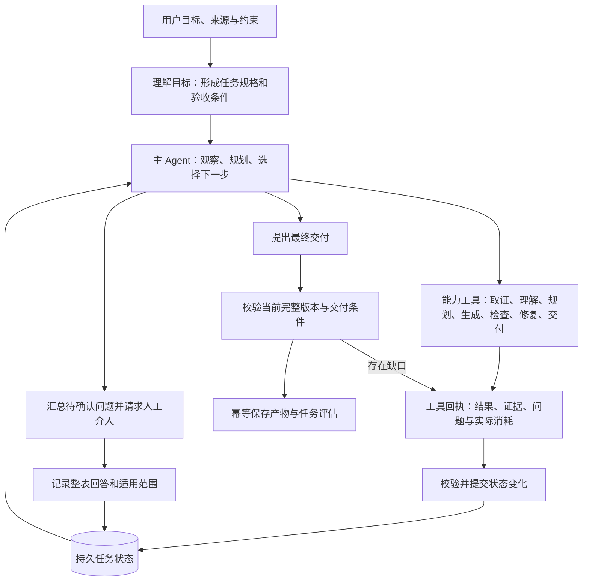
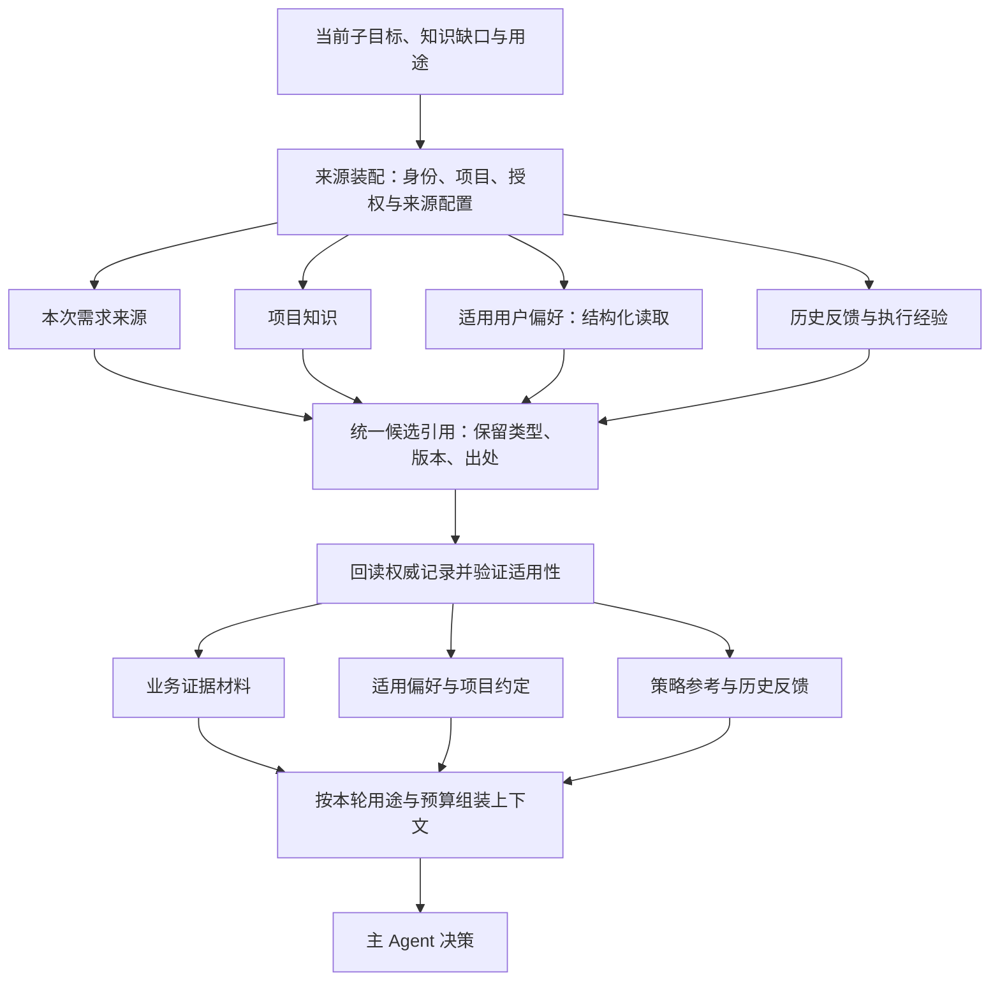

# 单主 Agent 架构与改造方案

日期：2026-11-12。状态：本轮第三、四阶段代码改造已收敛，工程验证与业务验收边界见第十八节。仓库内 `test_generation` 默认定义已替换为顶层 `AgentProgramDefinition`：一个主 Agent 接收 Run 原始输入，持久管理来源准备、规划、生成、独立复审和最终交付。旧生成 DAG 及其专用公开工具已退役；独立评估任务仍使用的通用 DAG 引擎继续保留。

工程回归、真实历史回放、新模型在线运行和人工业务验收分别记录。本轮不把历史 Run48 的来源回放算作新架构生成成功，也不制造人工定稿或长期反馈。第三阶段的真实业务闭环仍等待用户提交人工最终用例文档；确认后的反馈只能在同一项目跨任务复用。

建议让一个主 Agent 从用户原始目标开始，对理解目标、制定执行计划、选择工具、判断结果、调整策略和交付负责。现有的来源理解、测试规划、生成、修复和审查实现继续作为能力复用。改造的衡量标准是决策权、持久状态和实际行为发生变化。

“单 Agent”指整个任务只有一个目标与执行策略的所有者。它可以调用多种工具，工具内部可以使用模型、处理独立批次或进行有限的候选修正；工具不再各自维护一套竞争的长期任务计划。现阶段不按名称或数量直接删除所有专业模型调用。

**一、当前代码核查结果**

| 关注点 | 当前实现 | 需要调整的地方 |
| --- | --- | --- |
| 目标入口 | 顶层 AgentProgram 接收用户原始任务；确定性初始化固定来源，主 Agent 选择真实待办 | 新任务使用当前定义，历史冻结契约只读保留 |
| 决策循环 | 每轮观察当前状态及合法目标，选择来源分析、治理、草案、规划、生成或审查；终止提交重新验收全部依赖 | 在线行为和业务质量仍需真实任务验证 |
| 工具选择 | 主协调者绑定 21 个领域工具、11 个受管专业能力；同一目标与共享预算 | 专业能力不拥有另一套长期任务计划 |
| 结构化状态 | 领域 schema3 保存 source、prepared_input、planning、生成/审查版本、当前问题、修订、检索审计和 delivery | 工具选择及版本变更沿真实行动回执追溯，不用聊天正文充当状态 |
| 恢复 | 已有动作检查点、已验收子调用复用、预算与失租恢复 | 区分执行恢复与业务重规划，完成统一澄清后的真实交付验收 |
| 人工介入 | 来源支持初审后，先按明确依据修订草案，再定向复核剩余缺口；仍需人工决定的事项一次提交确认 | 完成真实澄清后的恢复与交付验收 |
| 执行轨迹 | 已有事件、工具回执、请求诊断和预算记录 | 将它们关联成可解释的策略轨迹与评估结果 |
| 成功率 | 有单次成功状态与 Token 数据 | 增加逻辑任务与运行尝试分离的评估统计 |

当前代码结构：

核心实现：

- [生成定义](../backend/modules/agent_platform/test_generation_builtin_specs.py)：顶层 AgentProgram、领域工具和受管专家授权；不再包含生成任务的 `nodes/display_stages/output_node_key`。
- [来源准备](../backend/modules/agent_platform/test_generation_source_agent.py)：真实来源、文本/视觉待办、逐项验收、完整来源效力和初始草案；来源材料随状态恢复。
- [统一生成领域](../backend/modules/agent_platform/test_generation_agent.py)：原始任务与规划输入分离、动态行动目录、修订依赖、审查和交付状态。
- [SDK 适配](../backend/modules/agent_platform/sdk_adapter.py)：冻结定义、共享预算、受管专业能力和来源产物投影；不启动子工作流。
- [自主工具循环](../backend/modules/agent_platform/autonomous_tools.py) 与 [动作日志](../backend/modules/agent_platform/action_journal.py)：反馈、无进展拒绝、原子回执、已验收结果复用和终止回放。
- [运行展示](../frontend/src/components/agent-platform/runPresentation.ts)：活动任务只消费冻结执行契约和 checkpoint v3 projection，不回读当前目录覆盖运行事实。

**二、目标结构：一个主循环，多个能力**

图中的工具是可选能力集合，不代表执行顺序。主 Agent 每轮依据当前事实、产物和失败反馈选择行动，也可以调整计划、合并行动、缩小修复范围或请求人工介入。

代码仍负责权限、输入输出契约、事实引用、数据依赖、预算、状态版本和最终提交。例如没有真实来源就不能生成确定的业务规则；候选修改后，旧批准失效。这样的限制来自正确性要求，不能为了增加路径变化而删除。

工具开放条件不再依赖“当前处于第几个阶段”。也不能把每个旧节点改名为工具，再始终只开放预设的下一步。存在真实数据依赖时只剩一个合法动作是合理的，限制原因必须可解释。

主 Agent 判断交付是否完整并提出提交，平台重新校验后完成保存。模型不能通过自由正文或自报成功跳过验收。

**三、明确区分两种计划**

现有 `accepted_plan` 与 `rebuild_business_plan` 主要描述测试覆盖业务计划：模块、覆盖意图、事实归属和用例分配。

新增的执行策略描述的是：为了完成本次目标，还需要解决什么问题、准备采取哪些行动、当前优先处理什么、失败后为什么换一种方法。两者分别保存，执行策略引用业务产物的标识和版本。

执行策略是可以修订的工作假设。主 Agent 可以取消已失去意义的步骤、改变顺序或调整粒度；平台不要求完成旧计划中的所有步骤。只记录与行动有关的简短决策依据和工具结果，不要求保存模型的内部思维过程。

持久状态建议沿现有 `action_state` 演进，避免另建一套状态系统：

| 状态内容 | 保存什么 | 更新约束 |
| --- | --- | --- |
| 任务规格 | 用户原始目标、理解后的任务范围、来源身份、验收条件 | 明确区分用户硬约束和 Agent 的解释；范围变化需要可追溯的用户决定 |
| 执行策略 | 当前子目标、可修订步骤、步骤状态、策略修订依据 | Agent 提出变更，工具校验并持久化 |
| 领域产物 | 来源事实、业务计划、候选用例、审查结果、交付版本 | 复用现有契约；通过校验的产物才可推进状态 |
| 依赖与版本 | 产物依赖的来源、输入、候选和审查版本 | 依赖变化使相应产物失效，缩小重算范围 |
| 问题与失败 | 来源歧义、规划问题、候选错误、工具/网络异常及处理状态 | 失败原因来自真实回执；不能把网络异常解释为业务规划错误 |
| 人工请求 | 问题身份、证据、影响范围、回答和继续条件 | 回答作为可追溯的用户决定保存，不改写原始来源 |
| 执行消耗 | 请求数、Token、时间、共享预算、等待时间 | 复用当前账本，恢复不清零 |

完整事实和大体积用例按范围读取，不必每轮塞入主 Agent 上下文。持久状态是任务事实依据，上下文是当前决策所需的工作视图。

**四、工具组织、并行和恢复**

| 能力范围 | 主 Agent 决定什么 | 能力实现返回什么 |
| --- | --- | --- |
| 读取与理解来源 | 读取范围、文本或视觉理解方式、是否需要补充证据 | 真实内容、来源定位、候选事实、未决疑问 |
| 建立与调整业务计划 | 规划粒度、覆盖组织方式、是否需要修订 | 结构化覆盖计划、依赖和可验证缺口 |
| 生成与修改候选 | 生成范围、独立批次组合、局部修复或重规划 | 候选用例、事实绑定和未完成范围 |
| 检查与评估 | 检查范围、顺序、是否追加审查及如何处理差异；任务规格要求的独立审查不可省略 | 确定性检查结果、绑定当前版本的独立审查结论 |
| 请求人工帮助 | 需要确认什么、证据是否已检查充分 | 已持久化问题表单及等待状态 |
| 提交与交付 | 当前目标是否已经完整满足 | 当前版本验收结果、保存结果与交付标识 |

工具说明需要声明输入、结果、副作用、依赖和可操作范围。工具参数引用真实来源或产物 ID，不让模型自行编造输入材料。来源理解优先沿现有解析和取证链路调整，以内容结构和数据契约组织规则，避免针对某篇文档增加特殊判断。

单工具与多工具的选择由主 Agent 提议，平台验证依赖与读写范围。独立读取、互不依赖的候选批次可以并行；依赖新产物的行动必须等待结果。每项成功结果独立留存，最终状态受控提交。

第一步复用现有批量调用和逐项回执机制。当前动作日志只允许一个未完成的领域动作，不能直接提高 SDK 工具并发参数，让多个工具同时覆盖整份共享状态。如果后续确实需要异构工具并行，应扩展原动作协议支持一个父动作中的分支回执，再做独立验收和合并。

失败处理采用清晰的职责划分：

- 传输、进程与 Worker 问题由执行层按原检查点恢复，保留预算和已验收结果。
- 能力内部可以在原范围、同一契约和有限预算内按真实校验差异修正候选；需要改变范围、能力调用预算耗尽或无法解决时，返回准确差异和已完成范围，由主 Agent 判断后续修复还是调整策略。局部预算耗尽不意味着可以重置共享预算。
- 来源不足或冲突时，继续检查本轮其余可检查范围，汇总完整问题后统一暂停。
- 人工回答后，重新判断依赖和受影响范围，统一修订并继续；不能仅把“恢复接口返回成功”算作完成。
- 没有新证据、产物没有变化的重复动作不能视为进展；预算耗尽时明确终止或等待明确的用户决定。

**五、评估口径必须在改造前确定**

任务成功要同时满足约定交付条件、当前版本检查与独立审查、产物保存和读回一致。用例数量达标、某个节点成功或模型声明完成都不足以单独证明任务成功。

| 指标 | 口径 |
| --- | --- |
| 端到端任务成功率 | 完整达到验收条件的逻辑任务数 / 纳入评估的逻辑任务数 |
| 无人工介入完成率 | 无人工介入且完整交付的逻辑任务数 / 纳入评估的逻辑任务数 |
| 故障恢复率 | 恢复后达到预定检查点或最终交付的故障事件数 / 纳入评估的可恢复故障事件数；两种恢复结果分别报告 |
| 澄清后完成率 | 人工整表回答后完整交付的任务数 / 已完成整表回答的任务数 |
| 产物质量 | 真实需求覆盖、证据正确性、可执行性与独立人工抽查结论 |
| 执行效率 | 请求数、Token、执行耗时、人工等待、无变化动作和无效重规划次数 |

逻辑任务与运行尝试必须分开：同一任务重试多次不能自动变成多个独立任务。用户取消、仍在等待、预算耗尽和失败分别记录；纳入分母的规则在跑任务前固定，并同时展示各状态数量。尚未结束的澄清任务单列为进行中；报表明确统计截止时间和任务集合，不将进行中与终态任务混算。

当前已取消随列表保留条数自动物理删除历史的行为，终态 Run、节点、事件和审批继续作为验收与消耗证据。此前被旧策略删除的记录无法恢复，因此任何成功率都必须说明纳入范围、截止时间、未知/进行中数量及分母；不能拿库里剩余记录冒称总体业务成功率。后续归档必须先保留逻辑任务/尝试身份、来源与执行版本、结果、独立质量结论及实际消耗。

**六、当前阶段边界与删除顺序**

| 阶段 | 当前状态 | 删除边界 |
| --- | --- | --- |
| 1. 运行契约基础 | 已完成；真实 Run、工作流定义和活动运行查询均使用当前协议 | 旧字段归一化、未声明模式、当前目录回读和旧契约重建分支已删除 |
| 2. 目标内自主循环 | 当前工程实现已完成，取证、规划、生成、修复和独立审查由同一持久主 Agent 管理；局部恢复已在线验证，完整交付继续验收 | 被替代的生成固定调度已退役，确定性校验和通用 Runtime 保留 |
| 3. 按需 RAG 与长期记忆 | 当前闭环已接通；主 Agent 通过 `retrieve_context` 按需读取统一来源并保存 manifest，长期记录支持待确认、确认、撤销和替代 | 继续用人工业务反馈验证来源采用质量；确认后再沉淀真实长期记忆，不把探针或模型自评写成事实 |
| 4. 生成旧路径、入口与展示清理 | 当前授权范围的工程改造已完成；单入口 AgentProgram 及对应前端展示已落地，完整在线交付与人工业务验收仍在进行 | 生成专用旧 DAG、公开工具及已替代入口已退役；通用 DAG 仍供独立评估使用 |

当前默认入口已经使用 `AgentProgramDefinition` 和顶层 `agent_network`，后续继续核验其真实交付行为。确定性审查和持久化在统一的提交边界内执行；被当前主循环完全取代的生成业务调度已退役，通用 Runtime 及其检查继续保留。

历史运行只读取已保存的执行契约快照；不把当前目录或新状态解释旧运行。通用 DAG 仍由独立用例评估等能力正式使用，因此保留其引擎；此次退役范围是生成业务的固定调度。后续重构直接使用当前协议，不增加兼容别名。

**七、真实验收清单**

使用实际来源和真实模型调用；历史真实回放只用于验证状态转换和恢复契约，不能代替新架构的在线行为验收。以下是持续使用的验收判据，已通过和待验收状态以第十八节及带采样时间的在线进度记录为准，不推算未经验证的成功率。

1. 真实简短需求、含表格/图片的文档和存在歧义的来源分别运行，轨迹体现有依据的取证方式、步骤粒度或工具组合变化。不能人为要求每个任务都选择不同路径。
2. 在确有多个合法选择时，主 Agent 能根据结果选择下一步；工具目录限制必须能追溯到权限、真实依赖或产物有效性，而不是阶段编号。
3. 真实历史失败输入用于复验来源问题、规划问题和候选错误的处理；网络失败不触发无关重规划，局部修复不重做所有已验收范围。
4. 在隔离验证 Worker 的真实运行中制造进程中断后恢复；检查已验收结果复用、预算保持、版本一致及无重复落库，不影响正在进行的用户任务。
5. 多项真实疑问完成检查后统一收集，用户整表回答后统一调整受影响范围，最终完成生成、独立复审、保存及读回。
6. 独立批次并行时，某项失败仍保留其他已验收结果；有依赖或发生版本冲突的结果不能被错误应用。
7. 同一组真实任务以固定来源、目标、验收标准和模型配置对照基线，记录全部尝试；每次模型调用都保留真实消耗，单次成功不外推总体稳定性。
8. 对交付结果做独立人工业务抽查，并检查历史详情清理后评估分母和结果仍然完整。

Run51 的真实进程中断及租约恢复、Run53 的真实整表答复后同 Run 恢复已有分别通过的证据；它们不等于完整生成交付或整体稳定性通过。当前仍需完成原需求的 70 条生成、独立终审、保存与导出、成功终止幂等读回，以及人工执行、定稿对比和同项目反馈采用质量验证。

后续拆分 Agent 的条件应来自执行数据：出现可独立验收的子目标、需要长期隔离维护的状态，或者上下文与并行成本已成为明确瓶颈，再引入第二个或第三个 Agent。文本提取、生成和审查使用不同模型配置，本身不足以证明需要独立的长期 Agent。

**八、按需 RAG：先明确知识缺口，再取证**

本节及后续章节定义信息、决策与可替换边界；已落地部分以当前代码和真实数据库校验为准，尚未完成的在线验收会单独标明。

当前知识库已有召回、关键词融合、重排、预算处理与检索评估基础。主协调者现已绑定 `retrieve_context` 语义上下文工具；已有 `read_planning_evidence` 是按本轮证据 ID 读原文，`document_search` 是单文档页面搜索，不能替代统一的跨来源上下文组装。

复用入口与缺口：

- [context_ops.py](../backend/modules/knowledge_base_components/context/context_ops.py) 的 `get_relevant_context_impl` 提供现有检索入口，普通模式返回拼接文本，调试模式返回检索诊断。
- [document_agent_tools.py](../backend/modules/agent_platform/document_agent_tools.py) 已有权限检查、来源清单、页面文本和版式读取。
- [document_index_service.py](../backend/modules/knowledge_base_components/document/document_index_service.py) 的资产索引已经携带原文定位信息；[retrieval_retry.py](../backend/modules/knowledge_base_components/retrieval/retrieval_retry.py) 的 `build_final_chunk_debug` 只输出部分元数据及截断片段。当前 `KnowledgeBaseContextSourcePort` 会从真实页面资产反查唯一正文区间，无法定位时返回 `unavailable`，不让调试响应承担业务证据协议。

建议把数据源分为三种用途，防止相似内容被误当成当前需求：

| 数据来源 | 用途 | 能否增加本次业务要求 |
| --- | --- | --- |
| 本次明确绑定的需求来源 | 确定当前需求、规则、验收和冲突 | 经来源核验、语义审查后作为依据 |
| 经授权的项目知识 | 补充术语、系统接口、已生效项目规则 | 必须验证适用范围、版本和效力；不自动覆盖本次明确要求 |
| 历史用例与执行经验 | 提示测试设计方式、已知风险和工具使用方法 | 不能仅因语义相似就成为本次必测规则或事实 |

主 Agent 决定是否检索及检索什么，检索工具负责检索算法、数据权限与资源限制。建议保留“搜索候选”和“读取原文”两个明确能力：

1. Agent 记录具体 `knowledge_gap` 与 `purpose`，说明要核实哪个子目标、缺什么信息。当前 state 已有充分且有效依据时，直接使用已有引用。
2. 选择资料范围与问题表达。项目/用户权限由执行上下文固定，不能接受模型传入任意项目身份扩大范围；Agent 可在授权集合内选择来源、版本或业务范围。
3. 复用现有召回、关键词检索、重排和去重，按本次用途与上下文预算返回候选目录。相似度是相关性信号，不是事实置信度或业务效力。
4. Agent 根据候选定位读取原始页面、相邻条件、表格表头或图片区域。展示的截断片段不作为完整规则。
5. 校验原文坐标、版本、权限和内容摘要；再判断是否支持当前主张。程序可以验证引用真实存在，业务语义是否正确仍需审查，不能由锚点校验替代。
6. 将实际采用的证据引用、支持范围、未决疑问和检索轨迹写入 state。搜索结果不直接覆盖已验收事实或人工决定。

正式检索回执至少保留：查询 ID、目的、实际过滤范围、资料/索引版本、候选 ID、文档 ID、来源类型、相关性分数、原文锚点、内容摘要、截断标记、检索状态及真实错误。页面、块、表格坐标、文本区间、图片区域按来源支持情况提供；不能编造缺失坐标。

没有结果时必须区分：确实没有命中、索引尚未准备、权限限制、服务异常、证据已过期。不能统一返回空字符串让 Agent 当作“业务规则不存在”。复用入口时应把现有诊断中的检索状态与错误显式传出。

当前 RAG 不足以证明“所有要求均已覆盖”。对于要求完整生成用例的任务，必须维护本次绑定来源的完整范围目录和检查进度。按需读取不意味着只检查 top-k 命中内容。查询没有命中，也不能证明某项要求不存在。完整性以明确的来源范围、已检查区间、覆盖项及排除理由验收；开放知识库的完整性通常不能作同等保证。

检索停止条件是：本次知识缺口得到足够支持、确认存在冲突、授权来源已检查但仍缺少决定，或资源边界已到。改写查询应针对新线索或未解决的具体缺口；没有新信息的重复检索不能当作进展。

**九、长期记忆、任务 state、上下文与缓存分工**

| 信息层 | 负责回答 | 生命周期与效力 |
| --- | --- | --- |
| 原始来源与证据 | 规则从哪里来，原文是什么 | 按来源版本保留；摘要和记忆不能改写它 |
| 长期记忆 | 跨任务有哪些已确认知识、偏好或经验证的方法值得参考 | 跨任务持久；必须附适用范围、依据和失效条件 |
| 当前任务 state | 本任务现在处于什么状态，哪些结果已验收 | 跨模型请求与进程恢复持久；描述当前任务的权威执行进度 |
| 本轮上下文 | 这一次决策或局部生成需要看到什么 | 从 state、证据与适用记忆构造的临时视图 |
| 结果缓存 | 相同输入与相同执行契约的计算结果能否复用 | 精确命中并重新验收，不负责跨任务经验迁移 |

当前平台已有任务 state、上下文投影、来源证据和严格结果缓存。本次代码核查未发现独立的跨任务长期记忆存储、晋升和检索闭环。需要新增的是受控的记忆能力，而非把现有所有历史回执重新命名为记忆。

长期记忆先限于三类：用户明确的项目约定与偏好、附真实来源的有效项目知识、附验证证据和适用条件的执行经验。每条至少包含 `memory_id`、所属用户/项目、类型、内容、适用范围、依据引用、来源版本、状态、确认/验证时间及失效原因。

记忆写入流程：模型提出候选 → 验证其依据与适用范围 → 确认或验收后生效 → 来源/规则变化后失效或重新验证。单次模型成功、自我总结、未经确认的推断和被拒候选不能自动晋升为项目事实。真实失败可以留存失败记录，但归因不明确时不能沉淀成确定的通用经验。

使用长期记忆时先按身份、项目、业务范围、版本和状态过滤，再按当前子目标检索；发现不匹配或来源变化应失效，不能只按相似度引用。业务知识的有效期由来源效力决定，不能统一设置一个时间窗口代表真实性。方法经验是行动建议，可以帮助选择工具，但不能改变验收条件。

用户本轮回答默认保存在本任务的确认记录中。要推广为项目长期规则，需要明确适用范围或已有持久授权；不能把一次冲突处理自动推广到所有任务。记忆中的过往偏好不得覆盖当前明确指令。业务资料之间的冲突依据任务确定的效力规则处理，没有授权规则时，不凭检索排名、时间较新或模型熟悉程度自行裁决。

长期记忆只能通过受控接口提出更新；工具返回与检索文档中的文字当作资料处理，其中的指令不能成为系统指令、扩大权限或直接触发记忆写入。记忆应支持撤销、纠正和删除，并使相关索引与后续引用同步失效。

不必把长期记忆全部塞进向量库。结构化约定与有效状态应保存为可精确查询的记录；向量索引负责找候选，不能成为唯一事实存储。先接通真实知识检索与任务状态，再通过实际重复任务验证长期经验的价值。

**十、结构化 state 与每轮上下文如何构造**

在原有 state 内增加明确的数据关系，而非把聊天历史复制进去：

- `task_spec`：目标、范围、硬约束、验收条件及版本。
- `strategy`：当前子目标、可修订执行计划、步骤状态及简短修订依据。
- `artifact_refs` 与 `dependencies`：产物标识、版本、有效性及依赖边界。
- `evidence_index` 与 `inspection_progress`：发现、检索、实际读取区间、锚点验证、语义支持判断、冲突和排除原因分别记录。
- `open_issues` 与 `human_requests`：未决问题、影响范围、阻塞关系、回答及适用条件。
- `memory_refs`：本次采用的记忆版本、用途及适用性检查。
- `last_outcomes` 与 `budget`：近期真实行动结果、失败分类、消耗和剩余边界；完整历史继续保存在原事件与回执中。

上述名称表示建议的数据职责，实施时合并或扩展现有对应字段，不另存两份相同领域事实。主 Agent 提议策略或领域变更，通过工具按预期状态版本校验后提交，不能直接编辑完整数据库状态。

每次模型请求的上下文由统一构造器生成，区分主 Agent 决策视图、局部生成视图和独立审查视图：

| 内容层 | 装入什么 | 裁剪规则 |
| --- | --- | --- |
| 必需约束 | 任务目标、硬约束、当前适用人工决定、预算与工具权限 | 不因历史压缩被丢弃；过大时明确拆分工作或停止请求 |
| 当前任务观察 | 当前子目标、产物版本、未决阻塞、可用行动及其范围 | 从当前 state 计算，替换旧观察，不持续叠加 |
| 本轮相关材料 | 当前行动所需原文、候选、依赖条件和适用记忆 | 按真实引用与作用范围装入，保持关键条件完整 |
| 近期反馈 | 最近失败、拒绝理由、实际变化及已尝试方法 | 保留与当前问题有关的反馈，历史完整记录可按需读取 |
| 可继续读取的目录 | 尚未装入的证据、候选和历史记录 ID | 提供工具入口，不能假装这些材料已经检查 |

决策视图关注目标、进度、问题和下一步选择；生成视图需要目标范围的完整事实与约束；独立审查视图需要当前候选、真实来源和标准，不把主 Agent 的自评当成审查答案。

预算按当前模型窗口、协议开销、工具 Schema、输出预留和当前任务用途计算。先去掉过期、重复和不相关材料，再按依赖拆成独立范围；不能简单删掉超出固定 Token 上限的末尾内容，也不能用固定百分比划分替代实际测量。某项规则的限定条件超出预算时，应扩大有授权的读取粒度或拆分任务，不能截断后断言证据完整。

每轮保存可重建的上下文清单：state 版本、任务规格版本、实际证据/记忆/产物引用、快照摘要、构造器版本及测量开销。全文已由请求诊断或不可变快照保存时引用它，避免重复存储；原始引用不可用时明确标记，不能宣称可精确重放。

现有 [sdk_adapter.py](../backend/modules/agent_platform/sdk_adapter.py) 的 `_PersistentStateInputFilter` 已有每轮当前观察、过期快照替换和重复读取压缩机制；[context_compression.py](../backend/modules/agent_platform/context_compression.py) 保留权威证据 ID。应沿这些机制演进，并维护“检索命中、完整读取、引用真实、语义充分”之间的区别。

**十一、决策与反馈循环的执行协议**

循环的顺序约束是“行动必须看到结果并完成状态验收后，才能依赖新结果决策”，业务路径仍由主 Agent 决定。

1. 恢复并验证持久 state，计算当前目标、未完成范围和合法行动。
2. 构造本轮上下文；若存在知识缺口，检索与读取本身就是可选择的行动。
3. 主 Agent 提议行动或独立行动集合，附目标范围、预期效果与简短选择依据；必要时修订执行策略。
4. 执行层验证权限、输入版本、读写依赖、所需批准和预算，执行工具并保存逐项回执。
5. 工具返回结构化 `outcome`：完成/部分完成/拒绝/业务缺口/技术异常/需要人工决定，附真实输出引用、变化范围、实际消耗和错误明细。
6. 确定性校验负责格式、来源定位、权限、版本和依赖；语义检查负责业务支持性和产物质量。通过后提交有效产物，未通过的候选留作诊断，不冒充成功状态。
7. 从最新 state 判断实际进展，主 Agent 选择继续、修复、补证、重规划、请求人工或提出交付。

`outcome` 的分类由真实执行状态与校验结果产生，主 Agent 可以解释业务原因，但不能将一个技术失败改写成工具成功。动作的“预期效果”用于比较真实结果，不等同于实际进展。

进展可体现为新证据解决疑问、有效产物变化、未完成范围缩小、明确排除一条不可行路径等，不能只看是否调用工具。相同状态、相同输入、没有新依据的无效重复需要被记录并限制。限制依据来自真实失败类别、可替代动作与共享预算，避免为了达成固定“重试 N 次”而重复无效工作。

在线检查不需要每个动作额外调用一个评分模型。先复用现有领域校验；关键里程碑或语义争议才执行独立评估。离线评估观察决策质量，但不能在运行中悄悄降低目标或验收条件。

**十二、Agent evaluation 的最小闭环**

评估需要同时回答“任务完成了吗”和“系统靠什么方式完成、代价如何、失败在哪里”。既不能只统计最终状态，也不能要求每次走固定标准路径。

| 评估层 | 检查内容 | 数据与判据 |
| --- | --- | --- |
| 检索与记忆使用 | 是否找到所需证据、是否引用过期/不适用内容、是否补齐限定条件 | 真实标注证据集的 Recall@K、MRR；原文引用正确性、实际采用的证据充分性、失效记忆误用 |
| 状态与上下文 | 新旧版本是否一致、约束是否遗漏、实际检查范围是否真实、恢复有无重复提交 | 状态/引用版本校验、上下文清单、恢复前后产物与预算对照 |
| 决策与恢复 | 工具是否适用、失败分类是否正确、是否有效调整策略、是否保留成功范围 | 真实轨迹、动作差异、故障事件及独立检查点结果；不按固定工具序列打分 |
| 人工介入 | 该问的是否问、问题是否完整、不该问的是否造成打断 | 对真实疑问与升级事件人工标注，记录遗漏介入、不必要介入、重复问题与回答后的完成情况 |
| 交付与效率 | 目标是否满足、用例是否有依据且可执行、是否成功保存 | 确定性验收、独立语义审查、人工业务抽查、读回一致性，以及真实时间和 Token |

现有 [RAG 指标](../backend/modules/rag_eval/metrics/metrics_retrieval.py) 可复用，但仅有检索命中率不能证明 Agent 成功。没有真实相关证据标注时，Recall/MRR 等指标应标记不适用，不能用模型猜测的标准答案冒充人工金标；“应当无答案”的检索任务单独评估正确识别证据不足的能力。

实现优先扩展原事件与回执，并补充两类独立于 Run 详情保留策略的轻量记录：

| 记录 | 核心字段 |
| --- | --- |
| 逻辑任务评估 | 稳定 task_id、目标与来源版本、任务规格/验收版本、评估集合与口径版本、当前状态、交付版本、尝试数、介入数、总消耗 |
| 运行尝试评估 | task_id/attempt_id/run_id、执行与模型配置版本、起止与人工等待时间、终态、失败分类、真实请求与 Token、拒绝/无变化动作/重规划计数 |

每项验收结果保存 `criterion_key`、标准版本、被评产物/状态版本、评估者类型（规则/模型/人工）、结果（通过/失败/未知）、依据引用及时间。故障、人工请求和策略修订使用稳定 ID 关联现有轨迹；第一阶段不为每个概念新建一张表。

硬性门槛单独判定，不能被平均总分抵消。缺来源、未完成必要复审或保存失败时，即使表达质量高也不算交付成功。模型评分保留原始依据，使用独立审查上下文，以人工抽查校准；争议结果记为未知或待复核，不能让被评 Agent 修改金标或自行授予成功。

离线任务集使用真实需求、真实历史失败和真实确认案例，覆盖简短需求、密集表格、图片、冲突、资料不足与长任务。开发、调参与验收集合按来源及其修订版本隔离，防止同一文档近似内容泄漏；比较前冻结来源、目标、验收、模型配置和检索配置。重复运行报告每次真实结果与波动，不只选最好一次。

在线聚合使用全部纳入范围的逻辑任务与尝试，明确截止时间和进行中状态。历史真实回放证明转换契约，真实新调用证明自主行为，真实故障恢复证明运行恢复；三类证据分别报告。清理详细轨迹前保留必要评估依据或不可变引用；若完整证据已被删除，应显示审计证据不可用。

用户中途缩小目标或调整验收后完成，应记录为“变更后规格成功”，保留原规格是否达成及变更原因。不能回写覆盖原基线，或把变更后的成功按原目标成功统计。

**十三、何时请求人工提供确定口径**

请求人工的依据是“继续推进需要一个当前授权材料和工具无法作出的决定”，而非模型笼统自报置信度低。确定性回答应尽量明确适用条件和处理规则，但人也可能无法确定；系统必须允许保留未决问题，不能逼用户从无依据选项中选一个。

| 场景 | 可先自主完成的工作 | 请求人工的条件与所需回答 |
| --- | --- | --- |
| 目标、范围、验收存在多种实质解释 | 检查原始输入、项目约定和当前可用来源 | 不同解释会改变交付且无授权判定规则；请确认具体范围或验收条件 |
| 来源互相冲突 | 对照原文、适用条件、版本和既有效力规则，继续检查其他独立模块 | 冲突仍不能消解；请指定采用口径、适用版本或提供权威来源 |
| 需求遗漏关键行为 | 定向检索并读取完整上下文，说明已检查范围 | 仍无法确定必需行为；请补充条件、操作、预期，或明确延期/排除范围 |
| 执行动作超出已有授权 | 准备实际动作、目标对象、参数和影响供审核 | 在执行前请求对该动作的授权；已有有效授权直接复用 |
| 不可逆或外部业务写入 | 依授权范围完成可审阅结果和必要前置检查 | 只有现有授权未覆盖该具体行为时请求批准，不能每轮重复问 |
| 预算/范围必须改变才能继续 | 保存有效结果、未完成范围与真实消耗，解释可选方案 | 请明确增加额度、缩小目标、延期或结束；Agent 不自行改变硬约束 |
| 技术异常或多次失败 | 执行层恢复，主 Agent 根据真实反馈换可行策略 | 只有确实需要用户补充环境/权限/资料或作范围决定时才请求；程序缺陷应定位修复或明确失败，不能让用户批准错误 |
| 已满足当前任务验收 | 完成校验、保存和读回 | 直接交付，不额外增加批准环节 |

人工请求分为业务澄清、执行授权和任务变更，不能混成一个“确定继续”按钮。业务澄清回答不能自动授权外部操作；允许某个工具执行也不能视作认可业务规则。

每项问题表单至少包含：稳定问题 ID、具体待决定事项、来源版本和原文引用、已检查范围、不同解释、影响产物/目标、所需回答结构及当前阻塞。确定选项只在证据充分时提供，允许补充权威来源、自由填写、保持待定、延期受影响范围或结束任务；延期/缩小目标必须作为用户明确的范围变更留痕。

问题身份以真实目标/主张、事实范围、缺口类别和来源版本建立，不以模型改写的 reason 文案决定。已有 [conflict_confirmation.py](../backend/modules/agent_platform/conflict_confirmation.py) 的身份仍包含 `coverage_fragment` 与 `reason`，需要沿现有链路改造，避免措辞变化导致重复提问；也不能只按事实集合合并，丢失同一事实上的不同疑问。

执行时先记录疑问并继续本轮其余可独立检查范围，待已知范围的问题完整收集后统一暂停；有依赖的产物保持阻塞，不基于猜测继续提交。任务无法继续取证，或在执行未经授权动作之前，按对应边界暂停，不为凑齐表单先执行动作。

回答后做三层处理：校验回答是否明确且完整 → 保存为带身份、范围、来源版本和时间的用户决定 → 按依赖统一修订并重新验收受影响产物。文本非空只能证明已填写，不能证明业务含义完整；答案仍模糊或互相矛盾时，只追问未解决部分。旧答案不覆盖新来源版本下的独立问题，也不改写原文。

现有冲突确认实现可以复用整表暂停、答案记录和等待时间处理。但动态工具统一审批仍存在接口缺口：[sdk_adapter.py](../backend/modules/agent_platform/sdk_adapter.py) 的 FunctionTool 当前设为 `needs_approval=False`，遇到 SDK 审批中断会报告尚未映射；固定工具节点的审批存储与门禁不能代表动态工具已全部覆盖。实施时应在原工具执行入口接入统一门禁，审批绑定动作参数、目标范围和有效状态版本，参数或作用范围变化后重新判定授权是否适用。

新增能力的实施依赖顺序建议为：先明确证据/状态/上下文协议并接通按需 RAG，补齐人工门禁和任务级评估；长期记忆先支持有依据的项目规则，再通过重复真实任务验证经验记忆。它们均围绕同一主循环组织，不再增加一套记忆 Agent 或评估 Agent 来承担长期业务控制。

**十四、可插拔：替换实现，保持执行与知识协议**

长期记忆与短期任务状态分开定义接口。短期表示只服务当前任务，不表示可以只存内存或随请求消失。长期表示跨任务可用，也不表示所有内容都可信。两者都可以更换持久化实现，但不能合并成一个只支持 `get/set` 的通用记忆模块。

| 边界 | 稳定接口职责 | 可以替换什么 | 必须保持什么 |
| --- | --- | --- | --- |
| 任务检查点存储 | 加载检查点、开始行动、提交成功/失败、保存预算与确认 | 满足执行协议的持久存储适配器 | 租约、预期版本、幂等、回执/状态/预算/事件一致性 |
| 长期记忆权威存储 | 按 ID/版本读取，提出候选，确认/验证、修订、失效、撤销和删除 | 记录存储实现 | 作用域、依据、版本、状态、写入权限和纠正历史 |
| 检索来源适配器 | 描述能力、按用途搜索候选、回读原记录、验证引用 | 文档库、记忆记录、反馈记录等来源实现 | 授权范围、语义角色、原始出处和来源状态 |
| 检索索引 | 写入/更新索引、搜索、删除、报告索引状态 | 向量或其他搜索实现 | 索引只是候选入口；使用前回查权威记录 |
| 上下文组装 | 从当前 state 和有效引用生成本轮视图及清单 | 选择、预算和压缩策略 | 必要约束与冲突不丢失，引用和版本可追溯 |

沿现有代码抽取边界，不先新增一套运行系统。[action_journal.py](../backend/modules/agent_platform/action_journal.py) 已把租约校验、状态版本、动作回执、事件与预算同步放在短事务中；以现有 `AgentActionJournal` 作为行为契约，逐步把具体持久化依赖收拢到适配器。`ToolExecutionContext` 可以接收既有运行上下文提供的能力接口，Agent 不接触数据库连接或后端选择。

任务存储接口必须表达完整提交：在某个有效执行所有权和预期状态版本下，提交当前行动的新状态、回执、预算变化与事件。不能先 `save_state` 再分别写回执和费用，让中断留下半份结果；也不能让 SQL、缓存和向量库分别成为进度、预算与批准的权威来源。

当前先保留已有数据库与事务。未来确需跨存储时，适配器必须证明相同的权威提交语义，并通过可靠事件更新其他投影；不具备一致性语义的后端拒绝启用。不能在写入失败后偷偷切换另一个后端继续写，形成分叉。

现有 [VectorStorePort](../backend/modules/knowledge_base_components/ports/vector_store_port.py) 与 [Chroma 适配器](../backend/modules/knowledge_base_components/adapters/chroma_vector_store.py) 已提供索引替换边界；继续复用，不增加一套专供记忆使用的重复向量访问层。向量库不能直接替代任务检查点或审批记录。

长期记忆的权威记录与索引分开：修订、撤销或删除先改变权威记录，再更新索引。索引滞后时，回读的版本与有效性检查仍要拒绝旧项。索引未准备好、没有命中和读取失败分别返回，不能把异步索引进度误报成知识不存在。

后端、接口协议和配置版本由可信配置装配并记录到运行身份。新任务可以采用新实现；进行中的任务固定原后端，或在没有进行中行动的检查点显式迁移。记忆的纠正和撤销则必须在后续使用前重新核验，不能用任务启动时的旧索引快照重新激活已撤销内容。

**十五、RAG 来源组装与分用途上下文**

RAG 的来源组装建议使用一个受控的来源注册表与共享检索主链。来源注册表管理“可以从哪里取”；检索路由管理“采用什么检索方式”；资料效力管理“取出的内容能用于什么”。三者分别建模。

图中的来源按用途选择，不要求每轮遍历所有来源。当前任务 state 通过检查点精确读取，不能依赖 RAG 搜索才能找到当前进度。关键用户偏好与适用约定也应优先做结构化匹配，不能因为语义召回未命中就遗漏。

候选可共用引用外壳，至少保留：`source_key`、`record_id`、`revision/content_hash`、原文或记录定位、`semantic_role`、所属与适用范围、有效状态、来源/确认依据、摘要标记，以及实际召回路由与分数。文档片段与记忆记录的专有定位放在各自类型中，不为不能提供页码的偏好编造文档坐标。

来源适配器按能力提供 `describe`、`search`、`read` 与 `validate`，结构化来源可提供精确匹配能力；不支持的能力明确声明，不用空结果伪装实现。检索操作只读取，记忆或偏好更新走独立写入协议。

来源装配流程：

1. 服务端根据当前用户、项目、任务与已授权来源形成可访问集合。Agent 可以在集合内选择用途和范围，不能用模型参数扩大集合。
2. 依据知识缺口选来源：核实业务规则查当前来源和有效项目知识；调整执行方法参考反馈与经验；应用呈现要求读取适用偏好。
3. 来源返回统一引用与候选。复用现有召回、关键词、重排和预算基础，保留每个来源的实际成功、部分可用、无命中或故障状态。
4. 先验证授权、作用域、版本和有效性，再做排序、回读与语义采用。不同来源的原始分数不能直接比较，使用经验证的融合方式；不能用相关性排名决定业务效力。
5. 去重时保留所有出处与派生关系。同一条原文被文档、摘要和历史总结重复引用，不算三份独立证据；不同语义角色不能因文字相同就被合并丢失。
6. 输出分用途材料：业务证据、适用约定/偏好、方法参考、未决冲突和来源不可用信息。共享上下文预算由当前用途决定，避免历史反馈挤掉必需原文和约束。

现有 [recall_pipeline.py](../backend/modules/knowledge_base_components/retrieval/pipeline/recall_pipeline.py) 支持向量存储与文档仓库注入，可作为渐进接入点。当前 `original/rewrite × raw/summary` 是检索路由，不是来源种类；现有文档数多样性约束不能直接转成“每轮至少取几条偏好或反馈”。

同文去重需要调整为保留多来源引用。现有 [recall_pipeline_helpers.py](../backend/modules/knowledge_base_components/retrieval/pipeline/recall_pipeline_helpers.py) 的去重主要保留胜出片段和召回路由，跨类型接入前须核验引用是否完整，不能在来源合并处断开证据链。

配置描述已注册的来源、用途、授权边界与资源预算，由装配入口解析；算法细节留在现有检索能力中。先实现当前真实来源所需配置，不为尚不存在的连接器搭建通用插件市场，也不按文档名称增加特例。

**十六、长期记忆中的历史反馈、用户偏好与项目知识**

三类内容共用存储、版本、检索与失效机制，但具有不同的写入与采用规则。长期记忆应保留这些语义类型，不能全部变成没有出处的自然语言段落。

| 类型 | 保存内容 | 写入与生效依据 | 使用边界 |
| --- | --- | --- | --- |
| 历史反馈 | 真实任务结果、用户评价、审查差异、失败现象、修正及修正后的结果 | 先绑定原任务、产物、版本、反馈者和证据；归因与方法验证分开 | 帮助判断风险与执行方法；不自动增加产品规则 |
| 用户偏好 | 用户明确的语言、格式、交互与工作方式，附用户/项目范围及生效条件 | 用户明确要求，或已有可证明的持久化授权；行为推断只作为待核实候选 | 影响适用的呈现和过程；不扩大工具权限、不降低验收条件 |
| 项目知识 | 有来源的术语、业务规则、接口约定、系统关系及明确项目决定 | 原始文档/系统记录或有权限者的明确决定，附有效版本和适用条件 | 经核验后支持当前任务，冲突按效力规则处理 |

历史反馈应区分四个层次：

- **发生了什么**：真实结果与错误现象，引用原始任务和回执。
- **谁如何评价**：用户反馈、规则检查、模型审查或人工抽查，保留评价者与被评版本。
- **为什么发生**：已证实原因与尚待验证的解释分开保存，不能从“效果不好”直接推出确定原因。
- **什么改进得到验证**：具体方法、适用条件、验证任务和正反结果；只有这一层才可能成为可复用方法经验。

用户明确反馈应立即作为反馈记录保留，不要求先证明其评价正确；但评价中的事实主张、原因解释或通用方法仍需分别核验。用户本轮纠正先进入当前任务决定，不能等长期索引更新才生效；是否推广到后续任务按授权和作用范围判定。

点赞、被采用次数、检索次数或成功次数反映有用程度，可作为排序参考；与来源效力、验证状态分字段保存，不能用高热度把未经证实的推断升级成业务事实。历史成功结果也不能仅凭“成功”状态免去当前事实与版本检查。

用户偏好先做确定性范围匹配，再处理相关内容：当前明确指令覆盖本次不一致的历史偏好；项目级偏好只在该项目生效，用户级偏好也不跨越组织授权边界。偏好改变后保留修订关系，不靠向量相似度决定哪条有效；同范围明确约定仍互相冲突时，只澄清冲突项。

项目知识优先引用现有知识库的权威来源与版本，记忆可以保存经过确认的结构化主张或可重建的派生视图，不复制维护第二份独立业务事实。来源修订、撤销或删除时，依赖的知识主张标记待复核或失效，相关索引同步更新。用户决定若明确改变项目规则，应保存决定者、适用范围、生效版本与被替代规则，原文保持可追溯。

跨任务反馈循环为：交付与评估产生真实记录 → 筛选有依据且可复用的候选 → 按类型验证或确认 → 形成有效记忆 → 新任务按需检索并验证适用性 → 记录采用后效果 → 纠正、降级或撤销。反馈循环调整检索与方法建议，不能由被评 Agent 自动改写任务金标、预算或验收门槛。

**十七、可替换实现的落地与验收**

第一阶段仅围绕现有真实实现抽取接口：当前数据库承接任务检查点，现有向量端口承接候选索引，现有文档资产承接来源回读；长期记忆权威记录使用独立的 `agent_context_records` 表。只有出现明确替换需求时再增加第二个实现。

本轮已增加 `modules/knowledge_base_components/ports/context_memory_port.py` 作为上下文边界：`ContextQuery` 固定查询范围和指纹，`ContextCandidate/ContextSourceRef` 保留来源、作用域、版本、内容摘要和证据，`assemble_context()` 按授权范围、撤销/过期状态和候选/字符预算确定性选择，并把拒绝原因写入 `ContextManifest`。当同一查询同时出现可用和不可用来源时，manifest 返回 `partial`，不再把部分可用误报为 `ready`。新增 `KnowledgeBaseContextSourcePort` 调用真实知识库 debug 检索并按文档 `content_hash` 回查版本；没有 manifest 页/块/表格锚点时明确标记不可精确引用。新增 `AgentContextRecord` 与 `ContextMemoryRepository`，只允许带证据的显式确认记录进入 active，并提供待确认、确认、撤销、替代和检索反馈记录。`OnDemandContextProvider` 按查询范围选择来源，再统一输出正文和 manifest；短期状态端口直接对齐绑定节点后的 `AgentActionJournal.load/init` 形状。主协调 Agent 已通过 `retrieve_context` 接入该 Provider，工具 artifact 保存 manifest 摘要、查询指纹、来源和拒绝原因。

按当前链路改造：

1. 从原 ActionJournal/Repository 封装稳定的检查点提交协议，保留当前原子性；把后端构造集中在现有服务装配入口。
2. 补齐带类型、作用域、来源与版本的长期记录，接入现有知识库引用；先支持明确偏好、项目决定和真实反馈，方法经验按验证结果晋升。
3. 在原检索链加入来源适配与统一引用，移除被替代的直接访问与重复组装逻辑；不要同时保留新旧两种对新任务有效的知识解释规则。
4. 上下文构造只依赖已装配接口，保存本轮实际引用和配置版本；停用某个来源时明确能力与覆盖缺口，不能静默宣告任务仍完整。

存储更换的验收使用真实任务快照与隔离副本，至少验证：完整输入/状态/产物/审批/回执/事件顺序/预算可还原；重复提交不重复生效；旧版本与失租执行器提交被拒绝；进程中断后已验收结果和费用不丢失。不能只迁移状态摘要。

索引更换验证真实引用、版本、权限和用途保持；来源不可用、部分可用和没有命中能够区分；撤销与删除即使索引滞后也不再被新上下文采用；变更 embedding 或分块方式后按对应索引版本重建，不能把不兼容的向量混搜。相同任务不要求新索引返回完全相同排序，但必须满足固定的证据与交付验收。

存储幂等不意味着外部行为恰好执行一次。业务写入优先使用稳定幂等键；外部服务不支持时，对“已执行但回执未保存”的未知结果先核实，不能盲目重发。影子比对只读取或写入隔离副本，不重复调用模型或业务写入。

迁移在受控检查点停止旧执行器写入，核验快照、切换所有权后再恢复。回退也要处理新侧已发生的提交，不能让两个后端同时拥有任务。适配器能力不满足协议时直接拒绝启用，不增加弱化一致性的兼容分支。

**十八、当前阶段与可核查边界（2026-11-12）**

| 阶段 | 工程实现 | 验收边界 |
| --- | --- | --- |
| 0 / 1：执行契约与运行基础 | 冻结 workflow/Agent/tool/model/runtime，保存逻辑任务与尝试身份，提供轻量摘要、指标、审批和增量事件；旧契约缺失时拒绝恢复 | 不用当前目录重建历史契约 |
| 2：目标内自主循环 | 取证、修订、生成、修复、独立审查和依赖失效已进入同一领域行动循环，预算和成功回执恢复不清零 | 行动回放与真实模型执行分别统计 |
| 3：按需 RAG 与长期记忆 | 真实项目知识、用户偏好、长期记忆、同项目已验证反馈和当前任务状态由 Provider/Port 组合；manifest、版本、作用域、确认/拒绝/撤销/替代已接通 | 当前没有真实两版用例评估和人工确认形成的 active 反馈，不能宣称业务质量验收通过 |
| 4：生成旧路径退役 | 仓库默认定义改为单入口 AgentProgram，删除生成专用 DAG 与其公开工具；前端按冻结契约展示真实主节点、行动及专家回执；用当前契约重写相关回归 | 已按用户明确授权启动真实模型验收并发布当前定义；真实生成、恢复、人工业务验收分别记录，不修改历史契约或伪造人工回答 |

统一 state 的 `source` 保存固定来源、完整原始证据、页面/坐标映射、文本/视觉输入与已验收记录、来源效力及草案。顶层 `action_input` 始终是 Run 原始输入，`prepared_input` 才是规划领域的可信输入，二者不能互换。专家上下文经 `managed_artifacts_provider` 从持久来源投影，不再依赖“上一 DAG 节点已经落盘”。每次行动只处理主 Agent 实际选择的当前待办；完整来源治理先于草案属于数据正确性约束。

终止行动 `finish_generation` 在同一领域提交内重新核验当前计划、事实、用例和独立审查，执行数量/结构/重复检查、执行套件构造及交付校验；最终结果保存到 `delivery` 后才允许完成。输出后处理再次按当前完整版本复验，并从状态导出 `test_generation`。因此终止回执重放也能恢复最终产物，不依赖第一次执行留下的 Python 字典。

checkpoint v3 将小型元数据与内容寻址的输入、状态、回执和专业结果分离；界面仅读取 projection。短期上下文检索按本次查询及预算取完整结构片段，保留 JSON Pointer、完整状态指纹、片段指纹和祖先约束；大状态不再因整份 JSON 超限而始终不可用，也不裁掉规则后半句。检索 manifest 进入行动状态，恢复时保持；它是审计元数据，不会自行改变业务产物的批准版本。

长期记忆与短期任务状态分别使用现有 Port 注入边界，当前权威存储仍是项目已有数据库与事务。没有需求时不增加第二套数据库或插件市场。替换实现必须保持来源、作用域、版本及提交一致性，不能靠写入失败后切换后端继续执行。`validated_feedback` 必须关联真实生成 Run、真实评测 Run、需求/生成/人工最终文档版本；差异只成为待确认候选，人工明确业务结论、适用范围和失效条件后才在同一项目生效。

本轮验证证据：

- [真实来源与草案重放](../output/qa/2026-11-12-single-agent-source-replay-real-data.json)：Run48、文档288 的 3 个文本、8 个视觉、1 个完整来源治理、10 个草案回执，按完整输入指纹和内容精确匹配。验证统一入口、分批选择、两次 JSON 恢复、来源产物注入、规划激活以及重复/越界/篡改拒绝；0 新模型请求、0 数据库写入。
- 前后端共用 [Run48 真实运行快照](../backend/tests/agent_platform/fixtures/run48.presentation.json)，验证冻结定义、冻结模型、旧 DAG 只读呈现、v3 失败行动/45 个专业回执和缺失执行模式拒绝；不是新单主 Agent 在线成功证据。
- [本轮收敛报告](../output/qa/2026-11-12-refactor-convergence.json) 记录后端 402 项回归、前端回归和构建、真实项目定义发布回滚、交付/来源回放及 59 个退役 QA 入口。此前 2026-11-04/06/11 的报告只代表当时环境，不用于推断当前成功率。
- [真实在线验收进度](../output/qa/2026-11-12-single-agent-live/acceptance-progress.json)：固定项目 8、文档 287 的原始《同步优学 · 产品需求文档.pdf》及 70 条目标。Run49 发现平台来源表示超限后正式取消；Run50 在模型调用前被版本一致性门禁拒绝；Run51 完成来源治理和规划后执行真实 Worker 中断恢复，继续准入因原预算上限停止；Run52 暴露在途预留挤占时整批取消的问题；Run53 在真实人工批准恢复后触及冻结预算失败；Run54 暴露整体合并漏传治理基线并已修复，Run55 按新契约继续验收。各轮状态、消耗、最终交付数量分别保留，原 Run 的冻结额度不修改。
- [来源表示容量修复](../output/qa/2026-11-12-run49-authority-capacity-fix.json)：复用完整事实的共享来源元数据，逐字段可逆还原，模型准入按实际投影计量；平台无法由模型修正的容量错误直接停止。Run51 实际 323 条事实、17 个来源专家结果、1 个完整治理及 24 个草案批次已在线完成，不能以 Run49 的 325 条替代本轮事实数量。
- [Run51 真实恢复核验](../output/qa/2026-11-12-single-agent-live/round-03/recovery-verification.json)：19 项检查通过。在 6 个模型请求未结算时终止真实 Worker，保留 76 个成功专业结果，原租约自然到期后由正式恢复器接管。6 个未知请求继续占用预留，恢复中的 18 个成功复核结果直接重放；后续新请求触及输入上限时停止。进程恢复、结果复用和预算门禁的通过不等于完整用例交付通过。
- [预算并发准入修复](../output/qa/2026-11-12-single-agent-live/budget-admission-implementation.json)：Run52 已报告输入 1,685,033，三个在途请求预留 288,198；下一请求导致临时投影超限时，旧实现取消了兄弟请求。现等待真实结算后重新判断；无在途请求或累计次数确实耗尽才拒绝，默认非严格批次先收敛已准入结果。未知预留不退款，等待不计新请求，恢复后重查执行权；主会话 `max_turns` 与 Run 父子共享请求额度分开约束。
- 主入口使用完整原始业务输入，执行身份从 `ToolExecutionContext` 提供，避免跨 Run 重试仅因新 `run_id` 改变输入哈希。真实来源及隔离 SQLite 检查点恢复回归覆盖此边界，DAG 内节点映射不变。该次中间后端回归 430 项通过、2 项跳过；最新整套回归见下文的 457 项。知识库真实乱序搜索 3 轮、查看原文后返回/刷新及跨项目筛选隔离已验证，前端构建通过。
- 用户已明确采用 10 月 29 日反馈：全部开放，绿点标记完成状态。Approval13 正式批准后，Run53/Node396 原位恢复，25 项核验通过；原109条专业结果与24条动作回执保留，91分17.658710秒人工等待完整排除出 deadline。随后在199个请求全部结算、0 pending/0 unknown时触及原输入上限，原Run及账本不改。
- 该真实恢复还暴露出治理基线丢失：稀疏补丁未重报的25条已判定事实退回 raw。修复后在经完整来源及结果指纹校验的基线上应用批准关系闭包内的补丁；支持复核只对模型来源元数据做无损共享，原事实和验收字段完整保留。Run54 发现的整体合并漏传基线也已修复，真实两补丁的来源治理、草案准备及规划初始化再次合并整链回放通过。当前457项回归通过、2项跳过。
- 新任务可显式引用 `source_context_run_id`，仅在同用户、同项目、完整来源快照和两个来源专家冻结定义/模型路由一致时，将历史原始候选通过当前后处理逐条重验。已批准口径必须与真实审批和原状态逐字相符；初始治理仅作为新真实治理的验收基线。该入口不继承旧规划、执行签名、租约或预算，不伪造新的模型调用；逐项溯源保存在结构化状态，模型只见范围摘要。Run55 已在线通过来源治理及规划初始化，原332条事实、25条旧正确裁决与真实批准口径均保留；后因生成预检平台缺陷正式取消，尚无最终用例交付。
- Run55 进一步暴露了生成预检的三处问题：容量把实际发送时会排除的大锚点算入16k限制；按共同事实交集误把相邻草案列为修复目标；意图支持完整但默认分组装不下时，验收前没有合法布局动作。现容量与发送共用投影、运行中按冻结定义取配置；按当前原子意图及汇总目录回溯原草案；计划验收前开放原布局工具，保持全部事实、意图和总预算，由正式分批器完整验证后再接受规划。[容量证据](../output/qa/2026-11-12-single-agent-live/round-07/generation-capacity-projection-fix.json) 和 [草案修订审计](../output/qa/2026-11-12-single-agent-live/round-07/draft-revision-audit.json) 分别保留真实失败及修复检查，不能当作新线上生成成功。
- Run56 的独立来源审计发现，已批准“全部开放”对应的新规范事实仍为 `uncertain`，却被本轮治理用于使旧规则失效。原25条裁决全部保留只是结构事实，不能视为新口径应用正确：该新规范事实本就在25条中，本次明确确认及候选治理关系应允许显式修订它，其余24条保持。该轮已正式取消，保存 [真实依赖审计](../output/qa/2026-11-12-single-agent-live/round-08/confirmed-governance-dependency-audit.json)；现已按完整候选关系求确认影响闭包，并禁止使用未生效事实作确定治理依据；Run57初始治理在线验证了该修复，不代替用户新增决定或自动激活规则。
- [按需检索核验](../output/qa/2026-11-12-single-agent-live/round-05/retrieval-audit.json)：Run53 实际检索 2 次，选入 8 个同项目片段，仅来自文档 286/287 的同版需求。无已确认长期记忆或业务反馈被采用；失去精确来源锚点的旧知识片段被排除，manifest 如实记录 partial。这验证作用域和来源审计，不证明检索内容已提供新的业务裁定或通过人工质量评价。

Run57 的初始真实治理已使“全部开放”规范生效，保留其余24条原裁决，并将新增来源关系与原人工批准分开记录。随后仅第1页9条事实发生重检变化，但旧实现未携带治理基线，使323条未变事实中的21条旧裁决退回raw默认效力；整批清除草案和参与输入指纹的技术批次编号又造成重复规划。该轮正式取消，保留212次已报告响应、3,324,172个已报告token及0条最终用例，不能声称交付完成。

已沿现有链路修复：同一固定来源按完整事实差异和治理依赖迁移裁决，保留一代可复算的迁移证明与原人工口径；重检期间保留旧草案，治理通过后仅按完整业务输入重投影可复用记录；批次编号移至artifact，模型输入只保留事实范围与用例预算；主题名称和目标合并为完整意图，避免丢失适用条件。使用Run57不可变真实回执的[来源迁移12项回归](../output/qa/2026-11-12-single-agent-live/round-09/source-authority-transition-regression.json)及[规划输入7项回归](../output/qa/2026-11-12-single-agent-live/round-09/planning-business-protocol-replay.json)已通过。离线复验明确区别历史旧hash与当前协议CPU投影，不伪称模型缓存命中；独立当前协议状态链路又验证了重检期间保留24份可复验草案，治理后26批中复用23份；其余3份保持待处理，未伪造模型回执。相关全量509项通过、2项跳过，另有收集后新增集成1项通过。修复后的新真实生成Run58已启动，最终交付仍待验证。

Run58 的真实执行验证了初始来源治理、原批准口径以及主题条件完整传递；26份初始草案经过两次真实局部修正，三版规划承接165→163条完整意图，来源归属专家保持17次，支持审查为39+4+2次，未发现相同完整输入重复请求。但人工门禁误把环节体系枚举当作按钮跳转变更，错误生成Approval14，独立原文复核后正式取消。该轮110次已报告响应、1,486,095个token、0条最终用例，未给误报问题伪造业务答案。详见[误报证据](../output/qa/2026-11-12-single-agent-live/round-10/approval14-false-conflict-audit.json)及[规划审计](../output/qa/2026-11-12-single-agent-live/round-10/planning-progress-audit.json)。

人工介入须分别验收“能否一致暂停与恢复”和“暂停理由是否成立”。本次误报说明，只有缺口标签、事实编号和说明文字不足以支持人工门禁；现沿原支持审查契约补充比较对象、适用条件、双方逐字原文及不能同时满足的依据，并保留在后续确认材料中。代码核验结构与出处，不冒称能确定性证明任意自然语言矛盾；语义质量仍以真实任务和独立原文复核评价。

Run59 已完成本轮真实生成验收：当前164条规划意图全部获得支持，原误报的末词跳转意图被真实审查正确判为supported；布局总量72、71两次被原子拒绝后，70条预算通过；30批真实生成、11个当前终审批次、两批修复及当前版本全局复审完成，最终70条与保存的当前审查版本完全一致。最终Run为success、232次已报告模型响应、输入3,262,716/output114,705/合计3,377,421个token，未知请求0；运行约50分钟，不能据此宣称性能已优化完成。[交付读回](../output/qa/2026-11-12-single-agent-live/round-11/delivery-readback.json)验证70个唯一编号、唯一完成回执、两次序列化重建和数据库零写；运行结束前后两次代码状态的交付结果摘要一致。[Excel核验](../output/qa/2026-11-12-single-agent-live/round-11/excel-openxml-verification.json)验证原平台导出70行8列与持久结果逐格一致。新代码启动后的真实页面显示成功、70条，刷新后保持，相关API均200。

运行结束后另整合两处确定性修复：默认分组在预算内先扩组并按完整支持闭包细化，替换原来支持分配失败早于扩组的顺序；真实Run55/59快照分别可直接产生27/26批、均为70条，约4秒CPU并通过原正式显式布局入口独立复验。生成请求按已有事实目录列表构造支持清单，避免ArtifactStore恢复改变dict迭代顺序而使相同领域状态产生不同请求指纹；真实2110请求在map重排、真实存储跨Session恢复及JSON轮回后均保持原指纹。此两处在成功Run59之后应用，以真实快照和永久回归验证，未伪称已用新默认分组重跑整轮模型。最终全量539项通过、2项可选独立Worker握手跳过；前后端及Worker同步冷启动正常。

剩余人工验收按第七节进行：用户执行或审核最终用例，结合实际环境补充存储观察入口及返回路径，并判断通用完成规则的跨模块覆盖是否需要合并；上传人工最终稿后进行两版对比、确认差异并验证同项目后续任务采用质量。当前没有真实修改稿或已确认业务反馈被晋升为active长期记忆。本轮没有触发来源重检，也没有再注入生成期Worker强停；来源迁移的真实历史快照回归、Run51真实进程强停恢复及预算保留、Run53真实人工确认恢复证据分别保留，不合并成单轮连续全部通过。当前只有一份需求的完整真实交付样本，不推导总体业务准确率。

后续不提前实现通用插件市场、独立记忆/评估/审批 Agent、任意异构工具并发或多层 Agent 拆分；需要第二个实际实现或真实性能证据后再扩展。

**十九、成本复跑与旧兼容收口（2026-11-13）**

本次用同一项目、同一来源版本、70条目标复跑。两轮均明确引用Run53的17份真实原始分析和批准口径，重新执行治理、规划、生成与审查；未把历史回放计为新模型调用，也未提升Run执行额度。

| 轮次 | 结果 | 已报告模型请求 / token | 耗时与边界 |
| --- | --- | --- | --- |
| Run59 | 成功交付70条 | 232 / 3,377,421 | 49分39秒；优化前完整交付基线 |
| Run60 | 正式取消，交付0条 | 104 / 1,366,359 | 18分01秒；复现成本后停止继续消耗，只用于诊断，不能与完整交付直接计算性能提升 |
| Run61 | 失败，交付0条 | 163 / 2,533,773 | 执行35分49.6秒，另人工等待48分12.4秒；人工原地恢复通过，后续规划完整性校验失败 |
| Run62 | 限流后恢复预算耗尽，0条 | 74 / 915,717 | 16分39秒；9次HTTP429未知用量另留预留，23草案及15归属结果实际复用 |
| Run63 | 来源重检后的治理容量失败，0交付 | 283 / 3,191,920 | 51分50秒，70仅为候选；明确引用62→61→53，并发3/1，不改历史契约 |

Run59的总账精确对齐。协调器输入1,260,048个token，支持复核输入983,868个token，合计占总输入68.8%；生成会话77次请求还包含23次实际场景咨询，不能全部叫作重试。部分诊断只保留最后200次请求，时间覆盖结论严格限于该可核查窗口，不冒称整轮所有时段。

本轮沿原链修正以下问题：

1. 内容寻址产物解码不再逐层重复深拷贝；各块仍核验租户、编码及完整摘要，交付时一次物化独立可变树，禁止相同引用形成可变别名。只读规划观察使用共享视图，修改行动仍取得隔离副本。
2. 持久观察按完整状态、输入、产物、人工口径和运行归属计算缓存身份；每次均重新计算完整内容指纹，任何变化继续走原来源校验。观察器不得修改输入。实时预算、取消/租约准入和当前错误不由该缓存替代。
3. SDK保留完整工具注册表以处理历史调用，传给模型的工具协议只含当前合法行动。来源行动返回实际进度回执；规划重复目录合并为单份裁决；当前不允许改布局时只给布局摘要，完整路由仍在状态及按需取证入口。
4. Run60真实归属候选把事实ID的`S0`误写为`S00`。明确的模型输出差异现在以`OutputValidationError`进入原提交反馈循环；输入协议、租约、身份和平台错误继续硬失败，不通过捕获所有异常来掩盖问题。
5. 旧DAG和新受管专家共享同一并发压力策略。原策略逐次成功抵消压力，真实交错限流未触发降载；改为稳定成功窗口恢复。受管会话按冻结的实际provider/model作用域跨行动、跨尝试保存控制头，不新增模型重试循环，不清除未知用量预留。Run60的99条真实交错事件CPU回放为一次6→5降载及一次稳定恢复；这不是新的在线429减少证明。

Run60未知用量为9次：5次HTTP429、4次归属后处理异常导致的兄弟取消；不能把9次都算成429。已报告消耗与保守预留分别保存，未伪造收费或退款。实际失败候选及随后真实成功候选用于局部反馈回归，未生成假模型收据。

Run61首次支持复核77次请求、944,484个token，Run59同阶段101次、1,306,299个token；输入减少28.23%，耗时从约646秒降至475秒。两轮意图数量分别168、164，并非逐请求完全相同的模型实验；只能说明该阶段的真实成本下降，不能据失败轮宣称70条完整交付已提速。Run61没有429、未知用量或预算耗尽，后续消耗来自真实修订及重新验收。

本轮真实运行暴露出两处源头缺口。第一，来源治理把原本uncertain的事实晋升为effective后，旧实现只过滤原planning_scopes，遗漏新生效事实；现在用既有`_planning_scopes`从治理后的完整effective_facts重新组装。真实274条事实全部进入规划且各出现一次，既有273条视图逐字段不变。第二，局部修订重输出整批草案，曾将已获支持的“本期适用”主题改回通用题型，制造新的无依据范围。现有修订动作按真实缺口保护其他完整主题及模块上下文，未修订的其他批次缺口继续作为结构化待办；来源或人工口径改变时清除旧待办，重新验收。自然语言业务正确性仍需独立审查及人工验收，结构保护本身不证明语义正确。

Run61审批15保存用户原话“分别适用：学前自测只存进度；语音跟读保存评分与进度（推荐）”。审批前95次请求与恢复后68次严格合计163，32份既有行动回执和79份已验收专家记录保持原指纹；输入、冻结契约和额度未改。运行时真正排除的等待为2892.411346秒；暂停至审批落库2909.704659秒还包含17.293313秒确认处理，不能全部当成人工等待扣除。人工暂停的BaseException早退原本跳过诊断附件，原95次细粒度请求轨迹不可追补；现已修正暂停保存及同Node恢复追加，预算账本一直完整，不制造缺失的模型明细。

Run62在24→43→66份已验收结果推进后仍按整个主节点累计4次暂态失败，最后协调器429使任务终止。这是从旧DAG节点搬到单主长任务时遗漏的恢复预算域。现按已提交领域状态及完整已验收专业身份/raw和normalized内容摘要界定恢复前沿，累计失败数保留，只有新验收进展才开始新的局部暂态窗口；同前沿连续4次仍停。失败日志、fork/cursor、预算递增不属于进展。内容错误、路由健康、终止锁存和Run费用不清零。真实SQLite及策略CPU回归、相关执行路径合计143项通过；Run63另作真实执行验证，不将CPU重演当作在线成功。

旧兼容此前未全部收口。开工时HEAD到工作区删除18,021行，其中生产及配置3,228行、QA运维13,350行；生产整体仍净增，不能把QA删除包装成生产净删几万行。本轮进一步移除无线上v2数据使用的升级函数和三个迁移脚本、旧内嵌回执辅助函数、无调用包装器、独立规划/终审的旧终止出口及其旧DAG QA。当前规划记录必须显式提供匹配的完整`input_hash`，删除缺失时自动补算放行的分支。

全库沿现有`ensure_builtins`同步26个真实项目：启用的旧生成DAG由24降为0，旧内置工具由614降为0。旧记录仅为历史引用保留；旧协议正常执行入口明确拒绝，不再提示已经删除的迁移入口。三个仍在使用的独立评估DAG、共享领域校验与历史只读呈现属于当前能力，继续保留。

审计与修复证据在`output/qa/2026-11-13-agent-cost-rerun/`。旧QA本身也暴露过时假设：不能擦除已有分支的历史节点后复用其唯一身份，也不能要求历史备份的可变状态永远不发生合法取消。验证改用独立临时控制节点并全部回滚，历史内容、执行权、时钟及表计数核对前后不变；首次失败记录保留。

仍需区分技术结果与业务验收。短期状态检索的全树序列化搜索、RAG原文及历史大参数的长期滞留仍有成本优化空间；未用复杂新策略掩盖这部分。本次修复收益以修复后完整模型复跑为准，CPU快照回归不替代线上性能数据。人工执行、人工最终稿对比及同项目反馈记忆验收继续等待真实材料。

**二十、成本验收失败后的架构更正（2026-11-13）**

用户明确正常规模生成应在20分钟、30万token以内。Run63实际51分50秒、319.19万token、283次请求，70条仅为候选、最终交付0；当前第三/四阶段不能判定收敛完成。约95.5%成本为输入，不能把整体异常解释为正常用例正文成本或仅归因于上游限流（本轮没有429）。

主协调器41次/74.56万、两轮生成含场景咨询136次/107.94万、规划及来源前置81次/108.91万、审查修复25次/27.78万。写第一批用例前已经88次/113.50万；即使没有后续BUG，固定多层模型前置也不满足目标预算。把入口改成单主Agent而保留完整草案、归属、支持、生成内嵌咨询等必经模型链，尚未达到目标驱动的按需调用。

下一步以能力和数据边界收缩：主Agent直接承担理解、覆盖计划与用例生成决策，确定性代码负责引用、编号、数量、重复、版本及预算；来源解析、视觉取证、项目RAG只按实际缺口调用；独立审查使用一致的有效来源、人工口径和问题上下文，局部修复只修改授权用例。取消默认多层专业会话串联，不以更换角色名称保留原调用量。生成批次按真实输入/输出容量组织，不能按过细的事实归属固定放大调用。

现有持久检查点、完整输入身份、费用账本、同项目记忆边界和人工确认保留。局部变更不得连带重写无关字段；未处理原子反馈必须跨重规划保留，只有独立裁决才能结案；无法自动确定的业务问题进入人工门禁，不能在批审与全局审查间反复改写。完整轻量请求边界不得因200条历史上限丢失。

20分钟/30万token是正常任务的成功验收约束，降低上限后快速失败不算达标。新发现的反馈生命周期、输入依赖、诊断保留与来源容量问题已有真实证据及隔离QA草稿，未全部实施；这些局部修复不能替代上述调用链收缩。停止自动新增付费整轮试跑，先完成可审查实现和预算证据，再恢复真实验收。详见`output/qa/2026-11-13-agent-cost-rerun/成本与重构核查结果.md`。
